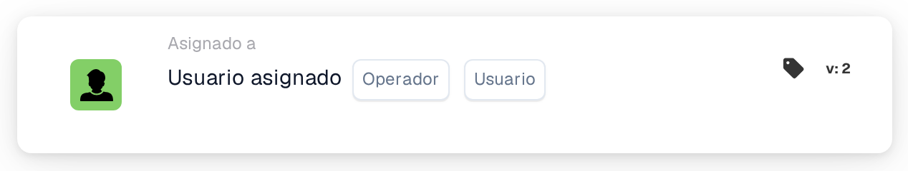

# Condición de usuario único asignado

<figure><figcaption>
Versión 2
</figcaption></figure>

**Propósito**

Esta tarjeta de flujo de trabajo facilita operaciones basadas en la asignación de una tarea o documento a un único usuario específico. Mediante un enfoque de lógica condicional directa, gestiona flujos de trabajo que requieren la participación dirigida de un usuario, garantizando la precisión en el tratamiento de tareas basado en usuarios.

**Componentes de la tarjeta**

1. **Operador**
   * **Descripción**: Especifica la lógica que se aplica a la asignación de usuario.
   * **Opciones**:
     * **IS**: Dispara la operación si el usuario asignado del documento o tarea coincide con el usuario especificado.
     * **NO ES**: Dispara la operación si el usuario asignado no coincide con el usuario especificado.
2. **Usuario**
   * **Descripción**: Permite seleccionar un único usuario con el que se comparará el usuario asignado.
   * **Detalle**: Esto implica un sencillo campo desplegable o de autocompletado donde se puede seleccionar un usuario a la vez.

**Funcionalidad**

* **Identificación de la asignación de usuario**: Identifica el usuario actualmente asignado a una tarea o documento específico.
* **Evaluación de la condición**:
  * Con el operador **IS**, la tarjeta comprueba si el usuario asignado es el mismo que el usuario seleccionado.
  * Con el operador **NO ES**, verifica que el usuario asignado sea distinto del usuario seleccionado.
* **Ejecución de la acción**:
  * **Condición verdadera**: Si la asignación cumple la condición establecida (IS o IS NOT), dispara acciones predefinidas, que podrían incluir avanzar con aprobaciones, iniciar tareas adicionales, enviar notificaciones u otros flujos de trabajo relacionados.
  * **Condición falsa**: Si la condición no se cumple, el flujo de trabajo no continuará.

**Interacciones del usuario**

* **Configuración**: Los usuarios configuran la tarjeta eligiendo un operador y seleccionando un usuario en el campo de usuario. Esta configuración debe ser sencilla, garantizando una selección y configuración de usuario fáciles.
* **Supervisión e informes**: Ofrece herramientas para supervisar el rendimiento de la tarjeta, como hacer seguimiento de qué tareas se disparan por asignaciones de usuario específicas y los resultados de esos disparos.
* **Gestión de errores y notificaciones**: Proporciona mecanismos para alertar a los usuarios si las tareas se asignan incorrectamente o si se producen errores operativos debido a problemas de asignación.

#### Conclusión

La tarjeta de flujo de trabajo "Single Assigned User Condition" es esencial para una gestión precisa de documentos y tareas específica por usuario dentro de un sistema ERP. Simplifica los flujos de trabajo centrándose en asignaciones de usuario individuales, garantizando así que las acciones solo se ejecuten cuando corresponda, según el rol y las responsabilidades del usuario. Documentar claramente esta tarjeta ayudará a los usuarios a comprender su aplicación, permitiéndoles implementarla y gestionarla de forma eficaz en sus operaciones diarias. Esta documentación garantiza que todos los posibles usuarios puedan captar fácilmente el propósito de la tarjeta e integrarla sin problemas en sus flujos de trabajo.

<!-- workflow-card-practical-example-20261021 -->

## Ejemplo práctico

**Cuándo utilizar:** Manejar la cola de un revisor en particular.

**Configuración:** Seleccione el operador igual y `Demo Reviewer A`.

**Resultado esperado y contraejemplo:** Pasa un documento asignado a ese usuario; otro usuario asignado falla.

Esta es una configuración ilustrativa y un resultado esperado. Utilice campos, usuarios y grupos configurados en su organización de prueba; no es una afirmación de que este ejemplo haya sido ejecutado.
