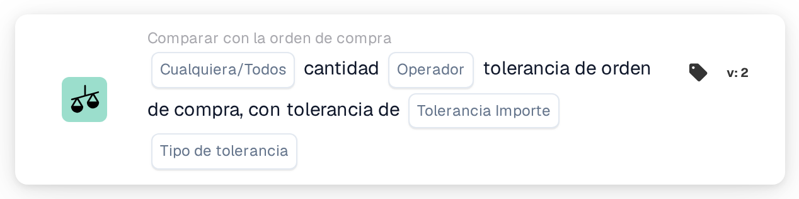
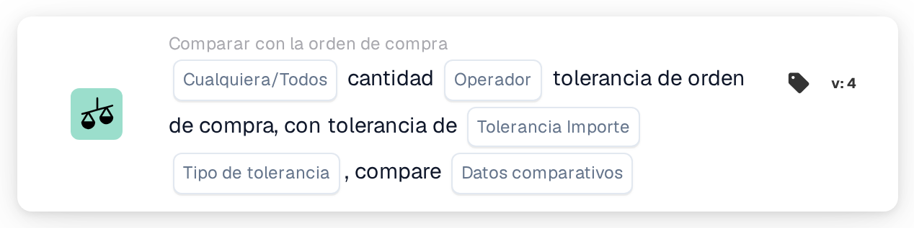

# Cualquiera/Toda Cantidad

<figure><figcaption>
Versión 2
</figcaption></figure>

<figure><figcaption>
Versión 3
</figcaption></figure>

<figure><figcaption>
Versión 4
</figcaption></figure>

## **Propósito:**

Esta tarjeta de flujo de trabajo está diseñada para comparar la cantidad en un documento con la tolerancia definida en la orden de compra. Permite a los usuarios evaluar si la cantidad cumple ciertas condiciones, como igualdad o exceder la tolerancia especificada. En la versión 4, la tarjeta amplía la funcionalidad agregando la capacidad de comparar múltiples entidades, incluida la orden de compra, las cantidades recibidas y las cantidades de documentos, ofreciendo mayor flexibilidad en el manejo de diferentes escenarios.

## **Componentes de la Tarjeta:**

1. **Cualquiera / Todos:**
   * **Descripción**: especifica cómo se debe aplicar la comparación entre múltiples elementos o condiciones.
   * **Opciones**:
     * **Cualquiera**: Al menos una de las condiciones debe ser verdadera para que se desencadene la acción.
     * **Todos**: todas las condiciones deben ser verdaderas para que la acción continúe.
2. **Operador:**
   * **Descripción**: Define la condición que se aplicará para comparar la cantidad del documento con la tolerancia especificada.
   * **Opciones**:
     * **Igual a (=)**: Comprueba si la cantidad coincide con el valor de tolerancia especificado.
     * **No es igual (≠)**: Garantiza que la cantidad sea diferente del valor de tolerancia especificado.
     * **Mayor que (>)**: Verifica si la cantidad es mayor que la tolerancia especificada.
     * **Mayor o igual (≥)**: Comprueba si la cantidad es mayor o igual a la tolerancia especificada.
     * **Menor que (<)**: Verifica si la cantidad es menor que la tolerancia especificada.
     * **Menor o igual (≤)**: Comprueba si la cantidad es menor o igual a la tolerancia especificada.
3. **Cantidad de tolerancia:**
   * **Descripción**: Especifica el valor de tolerancia con el que se comparará la cantidad del documento.
   * **Detalle**: Este valor es numérico y representa el umbral de variación permitida en la cantidad.
4. **Tipo de tolerancia:**
   * **Descripción**: Define el tipo de tolerancia que se aplicará.
   * **Opciones**:
     * **Porcentaje**: La tolerancia se calcula como un porcentaje de la cantidad de la orden de compra.
     * **Valor**: la tolerancia se especifica como un valor numérico fijo.

## **Componentes adicionales en la versión 4:**

* **Tipo de comparación**: Selecciona las entidades a comparar, proporcionando más flexibilidad en cómo se evalúan las cantidades en la Versión 4.
  * **Orden de compra al documento**: Compara la cantidad en la orden de compra con la cantidad en el documento relacionado.
  * **Recibido en documento**: Compara la cantidad recibida con la cantidad en el documento.
  * **Orden de compra a recibir**: Compara la cantidad de la orden de compra con la cantidad recibida.

## **Funcionalidad:**

* **Evaluación de condición:** El sistema compara la cantidad en el documento con la tolerancia en la orden de compra según el operador seleccionado y el monto/tipo de tolerancia. En la versión 4, el **Tipo de comparación** permite comparar diferentes cantidades, como orden de compra a recibir o orden de compra a documentar, lo que proporciona una comparación más dinámica.
* **Ejecución de acción:**
  * **Condición verdadera**: si la comparación resulta verdadera (por ejemplo, la cantidad de documentos está dentro del rango de tolerancia aceptable), el flujo de trabajo continuará.
  * **Condición falsa**: si la comparación resulta falsa (por ejemplo, la cantidad no cumple con la tolerancia), el flujo de trabajo no continuará.

## **Instalación y configuración:**

**Versión 3:**

* Los usuarios configuran la tarjeta seleccionando la cantidad de documentos, definiendo el monto y el tipo de tolerancia y eligiendo el operador apropiado para comparar la cantidad con la tolerancia. La tarjeta evalúa si la cantidad está dentro del umbral de tolerancia y procede con la acción "Verdadero" o "Falso" según el resultado.

**Versión 4:**

* Además de la configuración en la Versión 3, los usuarios pueden seleccionar el **Tipo de comparación**, lo que permite comparaciones entre diferentes entidades, como por ejemplo:
  * **Orden de compra para documentar**
  * **Recibido para documentar**
  * **Orden de compra a recibir**

## **Escenario de ejemplo:**

Una factura muestra que se entregaron 100 unidades, pero la orden de compra solo autorizó 90 unidades. El importe de la tolerancia se establece en 10 unidades y el tipo de tolerancia es absoluta.

* **Versión 3**: La tarjeta compara las 100 unidades del documento con la tolerancia de 90 unidades de la orden de compra. Si la cantidad excede la tolerancia, la tarjeta señala la discrepancia para una revisión adicional.
* **Versión 4**: La tarjeta podría comparar la **cantidad de orden de compra** (90 unidades) con la **cantidad recibida** (100 unidades) o la **cantidad de documento** (100 unidades). Dependiendo del **Tipo de comparación** seleccionado, verifica si la diferencia entre las dos entidades excede la tolerancia y activa la acción correspondiente.

## **Conclusión:**

* **Versión 3**: esta tarjeta de flujo de trabajo compara la cantidad del documento con la tolerancia de la orden de compra, lo que ayuda a garantizar que las discrepancias en la cantidad se marquen y se manejen de manera adecuada.
* **Versión 4**: Amplía esta funcionalidad al permitir a los usuarios comparar diferentes entidades, como orden de compra con recepción o orden de compra con documento, brindando mayor flexibilidad en el manejo de escenarios más complejos. La versión 4 garantiza un control más estricto sobre los flujos de trabajo de adquisición y recepción, ofreciendo comparaciones y acciones más dinámicas basadas en el tipo de comparación elegido.

Consulte [dirección de comparación, base de tolerancia y versiones de tarjetas guardadas](../../cards-overview/po-comparison-versions-guide.md) antes de cambiar los lados de comparación.
