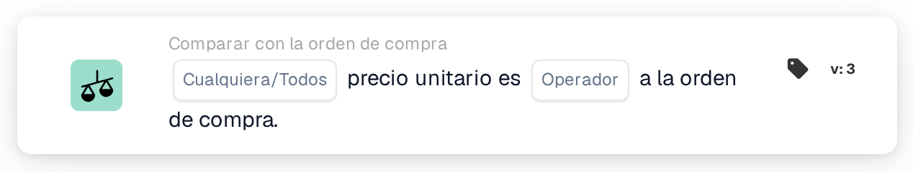
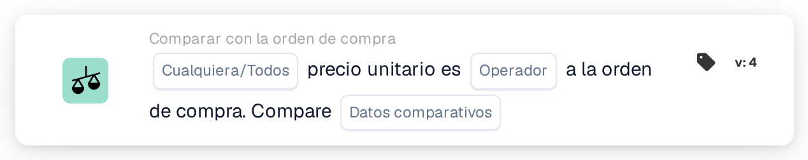
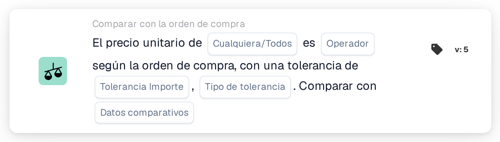

# Cualquiera/Todo el precio unitario es

<figure><figcaption>
Versión 2
</figcaption></figure>

<figure><figcaption>
Versión 3
</figcaption></figure>

<figure><figcaption>
Versión 4
</figcaption></figure>

<figure><figcaption>
Versión 5
</figcaption></figure>

## **Propósito:**

Esta tarjeta de flujo de trabajo se utiliza para comparar el precio unitario en un documento con el precio unitario en una orden de compra, asegurando que los precios se alineen dentro de los niveles de tolerancia definidos. La comparación puede desencadenar acciones si el precio unitario no cumple con las expectativas. **Versión 4** agrega más flexibilidad al permitir a los usuarios elegir diferentes entidades para comparar, proporcionando un nivel más profundo de control sobre los procesos de fijación de precios y adquisiciones.

## **Componentes de la Tarjeta:**

1. **Cualquiera / Todos:**
   * **Descripción**: Define si la condición se aplica a cualquiera o a todos los casos en los que se compara el precio unitario.
   * **Opciones**:
     * **Cualquiera**: La condición se cumple si algún precio unitario cumple con la condición de comparación especificada.
     * **Todos**: La condición se cumple solo si todos los precios unitarios cumplen la condición de comparación especificada.
2. **Operador:**
   * **Descripción**: Define la condición para comparar el precio unitario con el valor especificado.
   * **Opciones**:
     * **Igual a (=)**: Verifica si el precio unitario coincide con el valor especificado.
     * **No es igual a (≠)**: Garantiza que el precio unitario sea diferente del valor especificado.
     * **Mayor que (>)**: Verifica si el precio unitario es mayor que el valor especificado.
     * **Mayor o Igual (≥)**: Verifica si el precio unitario es mayor o igual al valor especificado.
     * **Menor que (<)**: Verifica si el precio unitario es menor que el valor especificado.
     * **Menor o Igual (≤)**: Verifica si el precio unitario es menor o igual al valor especificado.

## **Componentes adicionales en la versión 4:**

**Tipo de comparación:**

* **Descripción**: Permite a los usuarios elegir qué entidades se compararán además del precio unitario.
* **Opciones**:
  * **Orden de compra para documentar**: Compara el precio unitario en la orden de compra con el precio unitario en el documento.
  * **Recibido en el documento**: Compara el monto del lado recibido derivado de la orden de compra casada con el monto del lado del documento.
  * **Orden de compra a recibir**: Compara el lado de la orden de compra con el monto derivado del lado recibido.

## **Funcionalidad:**

* **Evaluación de condición:** El sistema compara el precio unitario en el documento con el precio unitario en la orden de compra (u otra entidad seleccionada, en la Versión 4) según el operador seleccionado. Si la comparación es verdadera, el flujo de trabajo continúa de acuerdo con los siguientes pasos, ya sea activando la aprobación o deteniendo el proceso.
* **Ejecución de acción:**
  * **Condición verdadera**: si la condición se evalúa como verdadera (p. ej., el precio unitario en el documento es mayor que el valor especificado), el flujo de trabajo continuará con la acción verdadera (p. ej., aprobación, procesamiento de documentos).
  * **Condición falsa**: si la condición se evalúa como falsa (por ejemplo, el precio unitario en el documento no cumple con la comparación), el flujo de trabajo no continuará.

## **Instalación y configuración:**

* **Configuración de la versión 3:** Los usuarios configuran la tarjeta seleccionando el precio unitario en el documento, eligiendo el operador apropiado para definir cómo se comparará el precio unitario con el valor especificado y estableciendo el valor con el que comparar. Además, los usuarios seleccionan si la condición se aplica a alguna o todas las instancias de la comparación de precios unitarios.
* **Configuración de la versión 4:** En la versión 4, los usuarios tienen la opción adicional de seleccionar el tipo de comparación. Esto les permite definir las entidades a comparar, como Orden de compra a documento, Recibido a documento u Orden de compra a recibido. Esto mejora la flexibilidad de la tarjeta para comparar precios unitarios en escenarios más complejos.

## **Escenario de ejemplo:**

*   **Versión 3 Ejemplo:**

    Una factura muestra un precio unitario de $50. La orden de compra relacionada tiene un precio unitario de $45. La tarjeta compara los dos precios unitarios utilizando el operador "Mayor que". Dado que el precio unitario en el documento ($50) es mayor que el precio unitario en la orden de compra ($45), el flujo de trabajo activará la condición verdadera (por ejemplo, enviar el documento para revisión).
* **Versión 4 Ejemplo:**\
  Una factura muestra un precio unitario de $50 y la orden de compra relacionada autoriza un precio unitario de $45. Además, la cantidad recibida es de 60 unidades. La tarjeta compara la cantidad recibida con el precio unitario del documento utilizando el operador "Mayor que". Dado que la cantidad recibida (60) es mayor que el precio unitario ($50), el flujo de trabajo activa la condición verdadera y el documento se marca para su posterior revisión.

## **Conclusión:**

La versión 3 de la tarjeta de flujo de trabajo "Comparación de precios unitarios" está diseñada para garantizar que los precios unitarios en los documentos se alineen con los de las órdenes de compra, lo que desencadena acciones basadas en condiciones definidas. La versión 4 amplía esta funcionalidad al introducir opciones de comparación más complejas, como comparar órdenes de compra con documentos, cantidades recibidas con documentos y órdenes de compra con cantidades recibidas. Esta flexibilidad adicional permite a las organizaciones manejar escenarios de adquisiciones y precios más sofisticados, mejorando el control y la precisión en sus flujos de trabajo.

## Versión 5 y dirección de comparación.

La versión 5 incluye Cualquiera/Todo, operador, cantidad de tolerancia, tipo de tolerancia y selección del lado de comparación. Las versiones más recientes ofrecen ambas direcciones del documento, orden de compra y comparaciones de datos recibidos. El lado de referencia determina la base de una tolerancia porcentual. Consulte [versiones de comparación de PO](../../cards-overview/po-comparison-versions-guide.md) para conocer las seis opciones, migración de tarjetas guardadas y ejemplos de prueba.
