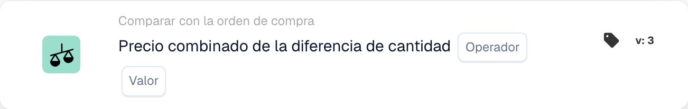
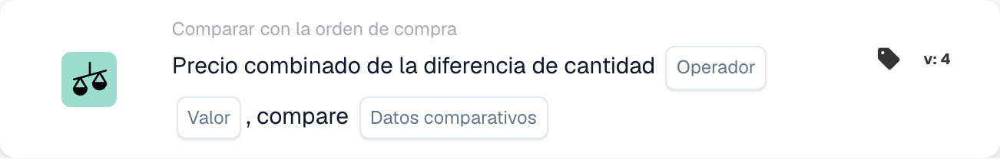

# Precio combinado de diferencia de cantidad

<figure><figcaption>
Campos de la tarjeta en la versión mostrada. Los campos aún no están configurados.
</figcaption></figure>

<figure><figcaption>
Campos de la tarjeta en la versión mostrada. Los campos aún no están configurados.
</figcaption></figure>

## **Propósito**:

Esta tarjeta de flujo de trabajo evalúa el precio combinado de una diferencia de cantidad, comparándolo con un valor específico. Ayuda a automatizar acciones basadas en discrepancias de precio y cantidad entre documentos relacionados, mejorando los flujos de trabajo de adquisición y recepción. **Versión 4** amplía esta funcionalidad al permitir comparaciones entre diferentes entidades, como la orden de compra, las cantidades recibidas y el documento en sí, agregando más flexibilidad y control al flujo de trabajo.

## **Componentes de la Tarjeta**:

1. **Operador**:
   * **Descripción:** La condición para comparar el precio combinado con un valor específico.
   * **Opciones:**
     * **Igual a (=)**: Comprueba si el precio combinado coincide con el valor especificado.
     * **No es igual a (≠)**: Garantiza que el precio combinado sea diferente del valor especificado.
     * **Mayor que (>)**: Verifica si el precio combinado es mayor que el valor especificado.
     * **Mayor o igual (≥)**: Comprueba si el precio combinado es mayor o igual al valor especificado.
     * **Menor que (<)**: Verifica si el precio combinado es menor que el valor especificado.
     * **Menor o igual (≤)**: Comprueba si el precio combinado es menor o igual al valor especificado
2. **Valor**:
   * **Descripción:** Especifica el valor con el que se comparará el precio combinado del valor de la cantidad.
   * **Detalle:** El valor tiene que ser un valor numérico.

## **Componentes adicionales en la versión 4**:

* **Tipo de comparación**: Selecciona las entidades a comparar. Las opciones incluyen:
  * **Orden de compra a documento**: Compara las cantidades y precios entre la orden de compra y el documento relacionado.
  * **Recibido en documento**: Compara las cantidades recibidas con las cantidades en el documento.
  * **Orden de compra a recibir**: Compara las cantidades de la orden de compra con las cantidades recibidas.

## **Funcionalidad**:

* **Evaluación de condición**: Calcula el precio combinado multiplicando la diferencia de cantidad por el precio por unidad y lo compara con el valor especificado utilizando el operador seleccionado.\
  **Versión 4** agrega la opción de comparar entidades adicionales según la configuración del usuario, como orden de compra para recibir o orden de compra para documentar.
* **Ejecución de acción**: según si el precio combinado cumple con la condición especificada, el flujo de trabajo continuará con condiciones verdaderas o falsas para desencadenar acciones o detener el flujo de trabajo. **Versión 4** también permite una ejecución de acciones más dinámica, donde el tipo de condición (por ejemplo, orden de compra a recibir) influye en el siguiente paso.

## **Instalación y configuración**:

* **Versión 3**: Los usuarios configuran la tarjeta seleccionando los campos del documento para la diferencia de cantidad y precio por unidad. Luego se elige al operador para definir cómo se comparará el precio combinado con el valor especificado. Finalmente, los usuarios establecen la condición de continuación (verdadero o falso), que dicta el siguiente paso en el flujo de trabajo.
* **Versión 4**: Además de la configuración en **Versión 3**, los usuarios tienen una opción adicional para configurar el **Tipo de comparación**. Esto define qué entidades se compararán, como **Orden de compra para documentar**, **Recibida para documentar** o **Orden de compra para recibir**.

## **Escenario de ejemplo**:

* Una factura muestra 50 unidades de un producto a $100 cada una, por un total de $5000. La orden de compra relacionada autorizaba una compra de $4500 por 45 unidades. La diferencia de cantidad es de 5 unidades y el precio combinado de la diferencia es de $500. La tarjeta compara la cantidad de la orden de compra (45 unidades) con la cantidad recibida (50 unidades) y verifica si el precio combinado es mayor que $400 (el valor especificado). Utilizando el operador **Mayor que (>)**, la tarjeta identifica la discrepancia y la señala para que el equipo de finanzas la revise.

## **Conclusión**:

**La versión 3** de la tarjeta de flujo de trabajo "Precio combinado de diferencia de cantidad" ofrece un enfoque sencillo para comparar discrepancias de cantidad y activar acciones basadas en umbrales de precio.\
**Versión 4** amplía esta funcionalidad al permitir comparaciones entre diferentes entidades (orden de compra, recibido, documento), brindando más flexibilidad y control sobre el flujo de trabajo. Las organizaciones ahora pueden automatizar escenarios más complejos y aplicar un control más estricto sobre sus procesos de adquisición y recepción.

Consulte [dirección de comparación, base de tolerancia y versiones de tarjetas guardadas](../../cards-overview/po-comparison-versions-guide.md) antes de cambiar los lados de comparación.
