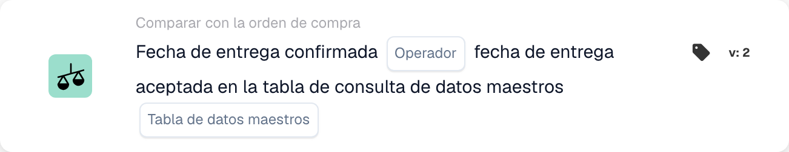

# Fecha de entrega confirmada

<figure><figcaption>
Campos de la tarjeta en la versión mostrada. Los campos aún no están configurados.
</figcaption></figure>

## **Propósito**

Esta tarjeta de flujo de trabajo está diseñada para verificar que las fechas de entrega confirmadas en las facturas o documentos de envío se ajusten a las fechas de entrega aceptadas definidas en una tabla de búsqueda de datos maestros. Al comparar estas fechas, ayuda a garantizar el cumplimiento de los plazos de entrega acordados y mejora la fiabilidad de la cadena de suministro.

## **Componentes de la tarjeta**

1. **Operador**
   * **Descripción:** Define la condición para comparar la fecha de entrega confirmada con la fecha de entrega aceptada.
   * **Opciones:**
     * **Is:** Confirma que la fecha de entrega coincide con la fecha de entrega aceptada en los datos maestros.
     * **No es:** Garantiza que la fecha de entrega no coincida con la fecha de entrega aceptada en los datos maestros.
2. **Búsqueda de tabla de datos maestros**
   * **Descripción:** Especifica la tabla de referencia que contiene las fechas de entrega aceptadas para la comparación.
   * **Detalle:** La tabla se define mediante el parámetro **Tabla de datos maestros** y puede incluir metadatos adicionales, como números de pedido o regiones de entrega.

## **Funcionalidad**

* **Comparación de fechas:** El sistema compara la fecha de entrega confirmada de la factura o el documento de envío con la fecha de entrega aceptada en la tabla de búsqueda de datos maestros especificada.
* **Ejecución de la acción:** Según el resultado de la comparación, la tarjeta puede disparar acciones de seguimiento como notificaciones.

## **Configuración**

* Para configurar esta tarjeta, los usuarios seleccionan el campo que representa la fecha de entrega confirmada en el documento y especifican la tabla de búsqueda de datos maestros que contiene las fechas de entrega aceptadas. A continuación, se elige un operador para definir cómo deben compararse las dos fechas (p. ej., **Is** o **no es**).

## **Ejemplo de escenario**

* Una factura indica una fecha de entrega confirmada del 10 de junio, mientras que la tabla de búsqueda de datos maestros especifica una fecha de entrega aceptada del 15 de junio. Usando el operador **no es**, la tarjeta señala la discrepancia para su revisión, permitiendo al equipo de logística investigar la causa y ajustar los plazos en consecuencia.

## **Conclusión**

La tarjeta de flujo de trabajo **"Fecha de entrega confirmada versus fecha de entrega aceptada"** ayuda a las organizaciones a mantener el cumplimiento de los plazos de entrega acordados automatizando la comparación de las fechas de entrega confirmadas y aceptadas. Este enfoque proactivo de la gestión de entregas mejora la eficiencia operativa, reduce los retrasos y fomenta una mejor colaboración a lo largo de la cadena de suministro.
