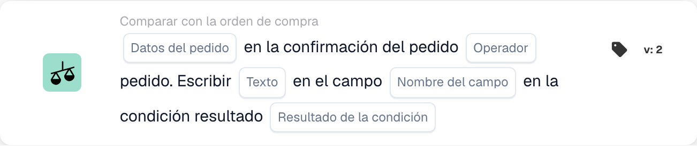

# Comparación entre la confirmación de pedido y el pedido de compra

Use **Comparar con la orden de compra** en el Constructor de flujo de trabajo cuando una confirmación de pedido deba comprobarse frente a su orden de compra. Añada la tarjeta bajo **Y....**, elija los datos del pedido, un operador y qué debe ocurrir con el resultado. Las capturas siguientes muestran dos versiones disponibles de la tarjeta en la interfaz en español. Sus campos aún son marcadores de posición; configúrelos para su propio flujo de trabajo antes de guardar.

## Escribir el resultado en un campo

<figure><figcaption>
Campos de la tarjeta en la versión mostrada. Los campos aún no están configurados.
</figcaption></figure>

Elija **Datos del pedido** de la confirmación de pedido y un **Operador** para la comparación con la orden de compra. Escriba el **Texto** que se debe escribir, seleccione el **Nombre del campo** y elija el **Resultado de la condición** que debe activar la escritura.

## Comparar los datos

<figure><figcaption>
Campos de la tarjeta en la versión mostrada. Los campos aún no están configurados.
</figcaption></figure>

Elija **Cualquiera/Todos** para decidir si una o todas las condiciones seleccionadas deben coincidir. Después seleccione los **Datos del pedido**, el **Operador** y los **Datos comparativos** para la comparación con la orden de compra.

Para los pasos siguientes, vea [Flujo de trabajo](../..) y [Comparar con la orden de compra](.).
