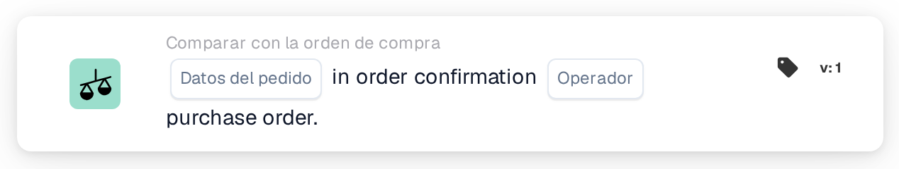
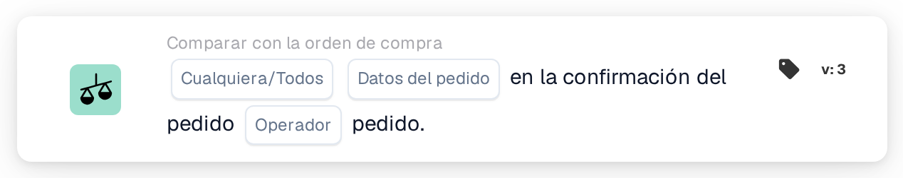
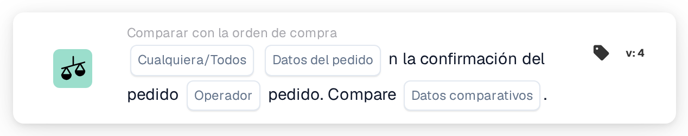

# Datos del pedido en la confirmación del pedido

<figure><figcaption>
Versión 1
</figcaption></figure>

<figure><figcaption>
Versión 2
</figcaption></figure>

<figure><figcaption>
Versión 3
</figcaption></figure>

<figure><figcaption>
Versión 4
</figcaption></figure>

## **Propósito**

Esta tarjeta de flujo de trabajo está diseñada para comparar campos específicos —**Precio unitario**, **Descuento** o **Cantidad**— entre una confirmación de pedido y una orden de compra. Garantiza la coherencia y el cumplimiento de los términos acordados. Según el resultado de la comparación, la tarjeta permite a los usuarios escribir un texto especificado en un campo elegido cuando la condición se evalúa como **true** o **false**, agilizando el procesamiento de documentos y reduciendo la intervención manual.

## **Componentes de la tarjeta**

1. **Datos del pedido**
   * **Descripción:** Especifica el campo que se comparará entre la confirmación de pedido y la orden de compra.
   * **Opciones:**
     * **Precio unitario**: Compara el precio unitario en ambos documentos.
     * **Descuento**: Compara el porcentaje o valor del descuento.
     * **Cantidad**: Compara la cantidad pedida.
2. **Operador**
   * **Descripción:** Define la condición que se aplica durante la comparación.
   * **Opciones:**
     * **Igual a (=):** Comprueba si el valor del campo seleccionado coincide entre la confirmación de pedido y la orden de compra.
     * **No iguales (≠):** Garantiza que el valor del campo seleccionado difiera entre los dos documentos.
3. **Texto**
   * **Descripción:** Especifica el texto que se escribirá en el campo de destino tras la evaluación de la condición.
   * **Detalle:** Este texto puede incluir notas personalizadas, actualizaciones de estado o valores predefinidos.
4. **Nombre de campo**
   * **Descripción:** Especifica el campo donde se escribirá el texto.
   * **Detalle:** El campo de destino se selecciona entre los campos editables disponibles dentro del sistema.
5. **Resultado de la condición**
   * **Descripción:** Determina cuándo debe escribirse el texto, según el resultado de la comparación.
   * **Opciones:**
     * **True:** Escribe el texto si se cumple la condición de comparación.
     * **False:** Escribe el texto si no se cumple la condición de comparación.

## **Funcionalidad**

* **Evaluación de la comparación:** El sistema compara el campo seleccionado entre la confirmación de pedido y la orden de compra usando el operador especificado.
* **Ejecución de la acción:** Si la condición se evalúa como **true** o **false**, el texto especificado se escribe en el campo designado.

## **Configuración**

* Para configurar esta tarjeta, los usuarios seleccionan primero el campo que se comparará —**Precio unitario**, **Descuento** o **Cantidad**—. A continuación, eligen un operador para definir la condición de comparación, como **equals** o **no es igual**. Los usuarios especifican el texto que se escribirá en un campo de destino y seleccionan cuándo debe ocurrir esta acción, según el resultado de la condición (**true** o **false**).

## **Ejemplo de escenario**

* Una confirmación de pedido indica un precio unitario de 50 $ para un producto, mientras que la orden de compra especifica un precio de 45 $. Usando el operador **No iguales (≠)**, la tarjeta identifica la discrepancia y escribe el texto "Price Mismatch" en un campo designado cuando la condición se evalúa como **true**.

## **Conclusión**

La tarjeta de flujo de trabajo "\[Unit Price/Discount/Quantity] in Order Confirmation" proporciona una solución práctica para garantizar la coherencia de los documentos. Al señalar automáticamente las discrepancias y escribir el texto pertinente en los campos especificados, mejora la eficiencia y reduce los errores en los procesos de gestión de pedidos.
