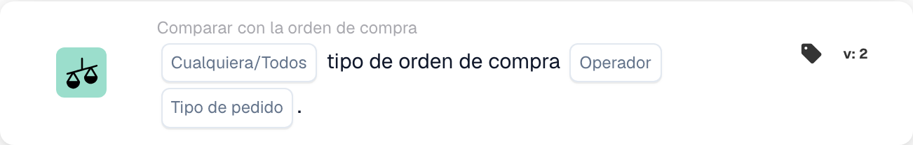

# Tipo de pedido de compra

<figure><figcaption>
Campos de la tarjeta en la versión mostrada. Los campos aún no están configurados.
</figcaption></figure>

## **Propósito**:

Esta tarjeta de DocBits permite verificar el tipo de pedido en una orden de compra, garantizando que se ajuste a los criterios especificados.

## **Funcionalidad**:

* **Comparación del tipo de pedido**: Esta tarjeta compara el tipo de pedido de la orden de compra con un valor especificado, permitiendo a los usuarios verificar si el tipo de pedido cumple ciertas condiciones.
* **Selección Any/All**: Los usuarios pueden optar por aplicar la comparación a **any** (al menos uno de los tipos de pedido seleccionados coincide) o a **all** (todos los tipos de pedido seleccionados coinciden) de los tipos de pedido especificados.
* **Operador**: Los usuarios pueden establecer condiciones para comparar el tipo de pedido en la orden de compra. Los operadores disponibles incluyen:
  * **Igual a (=)**: Confirma que el tipo de pedido de la orden de compra coincide con el tipo especificado.
  * **No iguales (≠)**: Garantiza que el tipo de pedido de la orden de compra no coincida con el tipo especificado.

## **Uso**:

Esta tarjeta es especialmente valiosa para los equipos de compras, los planificadores de inventario y los responsables de operaciones que necesitan categorizar y priorizar los pedidos con precisión. Al garantizar que los tipos de pedido coincidan con las clasificaciones previstas, los usuarios pueden agilizar la gestión de pedidos, optimizar la asignación de recursos y cumplir los acuerdos de nivel de servicio.

## **Ejemplo de escenario**:

* Una orden de compra está categorizada como "IGR". El sistema usa el operador "Equals" para verificar que este tipo de pedido se ajuste a la clasificación prevista para su procesamiento.

Al usar la tarjeta "Compare with Purchase Order: Order Type", las organizaciones pueden automatizar la validación de los tipos de pedido, garantizando la coherencia en las prioridades de procesamiento y reduciendo los errores de clasificación manual.
