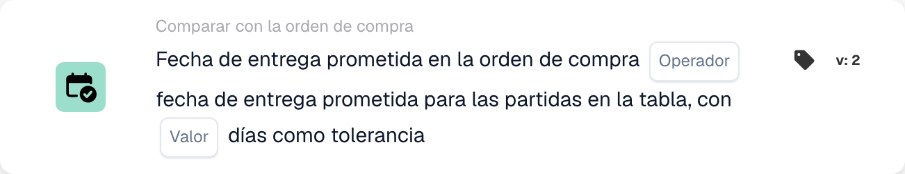

# Fecha de entrega prometida en la orden de compra

<figure><figcaption>
Campos de la tarjeta en la versión mostrada. Los campos aún no están configurados.
</figcaption></figure>

## **Propósito**

Esta tarjeta de DocBits está diseñada para facilitar la comparación precisa de las fechas de entrega prometidas en las órdenes de compra con las fechas de entrega especificadas para las líneas de una tabla. Al integrar un valor de tolerancia, la tarjeta garantiza flexibilidad en el seguimiento de los plazos de entrega, ayudando a mantener la precisión de la planificación de inventario y la satisfacción del cliente.

## **Componentes de la tarjeta**

1. **Operador**
   * **Descripción:** Define la condición que se aplica para comparar las fechas de entrega.
   * **Opciones:**
     * **Igual a (=):** Comprueba si la fecha de entrega prometida de la línea coincide con la fecha de entrega de la orden de compra.
     * **No iguales (≠):** Garantiza que la fecha de entrega prometida de la línea no coincida con la fecha de la orden de compra.
     * **Mayor que (>):** Verifica si la fecha de entrega prometida de la línea es posterior a la fecha de entrega de la orden de compra.
     * **Mayor o Igual (≥):** Comprueba si la fecha de entrega prometida de la línea es igual o posterior a la fecha de entrega de la orden de compra.
     * **Less Than (<):** Confirma si la fecha de entrega prometida de la línea es anterior a la fecha de entrega de la orden de compra.
     * **Menos o Igual (≤):** Valida si la fecha de entrega prometida de la línea es igual o anterior a la fecha de entrega de la orden de compra.
2. **Valor**
   * **Descripción:** Especifica un margen de error admisible en la comparación de fechas de entrega.
   * **Detalle:** Los usuarios definen el número de días en que la fecha de entrega de la línea puede diferir de la fecha de entrega prometida.

## **Funcionalidad**

* **Evaluación de la condición:**\
  La tarjeta calcula la diferencia entre la fecha de entrega prometida de la orden de compra y las fechas de entrega de las líneas de la tabla. A continuación, se aplica el operador seleccionado para determinar si se cumple la condición.
* **Ejecución de la acción:**
  * **Condición verdadera:** Si la diferencia de fecha de entrega está dentro del rango de tolerancia y cumple la condición establecida por el operador, el flujo de trabajo continúa.
  * **Condición falsa:** Si la condición no se cumple, el flujo de trabajo no continuará.

## **Configuración**

* Se selecciona el operador para definir la condición de comparación deseada, como igual a, mayor que o menor que. Por último, los usuarios especifican un valor de tolerancia en días, que permite pequeñas variaciones en la comparación sin disparar alertas.

## **Ejemplo de escenario**

* Una orden de compra especifica una fecha de entrega prometida del 1 de diciembre. Una línea de la tabla tiene una fecha de entrega prometida del 3 de diciembre. Con un valor de tolerancia establecido en 2 días y el operador **Equals (≥)** seleccionado, la tarjeta considera que la fecha de entrega está dentro del rango aceptable. No se dispara ninguna alerta, garantizando que las variaciones menores se toleren sin interrumpir las operaciones.

## **Conclusión**

La tarjeta "Promised Delivery Date Comparison" ayuda a agilizar las operaciones de la cadena de suministro al permitir un seguimiento preciso de los plazos de entrega. Con su capacidad para incorporar tolerancias y operadores de comparación flexibles, garantiza el cumplimiento de las expectativas de entrega evitando alertas innecesarias por desviaciones menores. Esto mejora la gestión de proveedores y la eficiencia general del flujo de trabajo.
