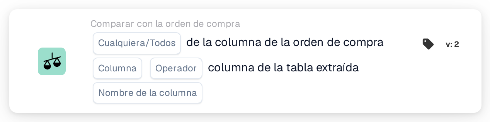
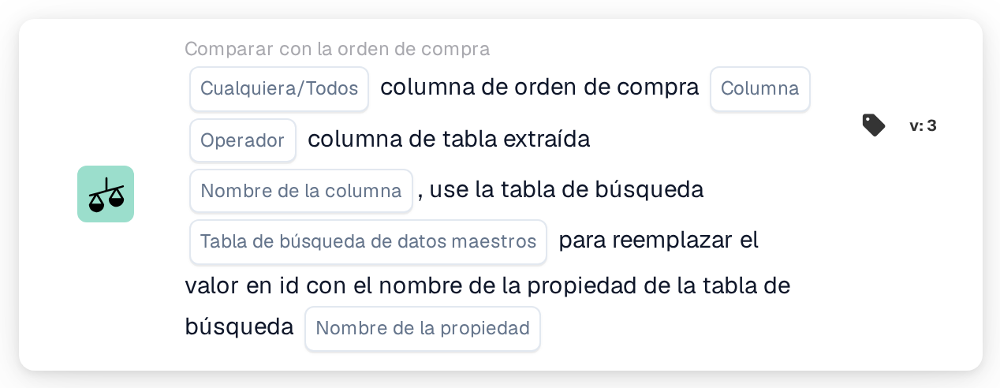

# Columna de la orden de compra y columna de la tabla extraída

<figure><figcaption>
Versión 2
</figcaption></figure>

<figure><figcaption>
Versión 3
</figcaption></figure>

## Propósito:

Esta tarjeta de flujo de trabajo compara una columna de las líneas de orden de compra emparejadas con una columna de la tabla de líneas de artículo extraída del documento. Para cada fila del documento que la conciliación de la orden de compra haya emparejado con una línea de orden de compra, el valor de la columna seleccionada de la orden de compra se compara con el valor de la columna de tabla seleccionada en esa fila. A continuación, los resultados individuales se combinan con el ajuste **Cualquiera/Todos** en el único resultado de la tarjeta.

La versión 3 puede, además, traducir el valor de la orden de compra mediante una tabla de búsqueda de datos maestros antes de la comparación, lo que resulta útil cuando la orden de compra y el documento utilizan códigos diferentes para lo mismo, por ejemplo códigos de unidad diferentes.

La conciliación de la orden de compra debería ejecutarse antes de esta tarjeta. Sin una orden de compra emparejada, la tarjeta informa de datos faltantes.

## Componentes de la tarjeta:

1. **Cualquiera/Todos**
   * **Descripción:** Cómo se combinan las comparaciones de las filas individuales en el resultado de la tarjeta.
   * **Opciones:**
     * **Cualquier:** Al menos una fila comparada cumple la condición.
     * **Todos:** Cada fila comparada cumple la condición. Si no se ha definido ningún valor, la tarjeta utiliza **Todos**.
2. **Columna**
   * **Descripción:** La columna de la línea de orden de compra cuyo valor se compara.
   * **Detalle:** El valor se lee de la línea de orden de compra que se emparejó con la fila del documento.
3. **Operador**
   * **Descripción:** Cómo se compara el valor de la orden de compra con el valor del documento. El valor de la orden de compra está en el lado izquierdo de la comparación, por lo que **Mayor Que** significa que el valor de la orden de compra es mayor que el valor del documento.
   * **Opciones:**
     * **Es igual a**
     * **No es igual a**
     * **Mayor Que**
     * **Mayor o igual que**
     * **Menor que**
     * **Menos o igual**
4. **Nombre de la columna**
   * **Descripción:** La columna de la tabla extraída del documento que se compara con la columna de la orden de compra.
   * **Detalle:** La tarjeta utiliza la primera tabla extraída del documento.
5. **Tabla de búsqueda de datos maestros (solo versión 3)**
   * **Descripción:** Una tabla de búsqueda opcional que se utiliza para traducir el valor de la orden de compra antes de la comparación.
   * **Detalle:** El valor de la orden de compra, convertido a mayúsculas, se busca en la propiedad **codevalue** de la tabla de búsqueda. Si se encuentra un registro y este tiene un valor para el **Nombre de la propiedad** seleccionado, el valor de la orden de compra se sustituye por el valor depurado de esa propiedad. Si no se encuentra ningún registro o ningún valor, se utiliza el valor de la orden de compra en mayúsculas. El valor del documento no se traduce.
6. **Nombre de la propiedad (solo versión 3)**
   * **Descripción:** La propiedad del registro de la tabla de búsqueda cuyo valor sustituye al valor de la orden de compra.
   * **Detalle:** **Tabla de búsqueda de datos maestros** y **Nombre de la propiedad** pueden dejarse ambos vacíos; en ese caso, la tarjeta compara los valores sin traducción. Si solo se ha definido uno de los dos, la tarjeta informa de datos faltantes.

## Funcionalidad:

* **Evaluación de la condición:** Para cada línea de orden de compra emparejada, la tarjeta busca la fila de la tabla del documento (o, en la versión 3, las filas) emparejada con ella y compara los dos valores con el operador seleccionado.
  * Si ambos valores son números, se comparan como números.
  * En caso contrario, se comparan como texto. Con **Es igual a**, las diferencias entre mayúsculas y minúsculas no cuentan. En la versión 3, ambos valores se convierten a mayúsculas antes de la comparación; un valor tomado de la tabla de búsqueda se utiliza tal como está almacenado en ella. Los operadores **Mayor** y **Menor** comparan el texto por simple orden de caracteres, por lo que son útiles principalmente para columnas numéricas.
* **Ejecución de la acción:**
  * **Condición verdadera:**\
    Con **Todos**, cada fila comparada cumple el operador; con **Cualquier**, al menos una lo cumple. El flujo de trabajo continúa.
  * **Condición falsa:**\
    Si el resultado combinado no se cumple, el flujo de trabajo se detiene con una condición no cumplida.
* **Datos que faltan:** La tarjeta no evalúa la condición e informa de datos faltantes en el registro del flujo de trabajo cuando:
  * el documento no tiene ninguna orden de compra emparejada, o los datos de una orden de compra emparejada no están disponibles,
  * el documento no tiene ninguna tabla extraída,
  * la columna de la orden de compra de una línea comparada está vacía (un valor numérico de 0 también cuenta como vacío),
  * la columna de la tabla de una fila comparada está vacía o no existe,
  * no se ha podido comparar ninguna fila,
  * no se ha definido una entrada obligatoria (en la versión 3, también cuando solo se ha definido una de las dos entradas de búsqueda).

## Configuración:

* La tarjeta se puede añadir como condición And después de la conciliación de la orden de compra, desde la categoría **Comparar con la orden de compra**. A continuación se pueden seleccionar **Cualquiera/Todos**, la **Columna** de la orden de compra, el **Operador** y el **Nombre de la columna** de la tabla del documento. En la versión 3, se podrían añadir una **Tabla de búsqueda de datos maestros** y un **Nombre de la propiedad** cuando la orden de compra utiliza códigos distintos de los del documento.
* Para comprobar una configuración, se puede utilizar **Tarjeta de prueba** en el menú de la tarjeta del Workflow Builder con un documento existente. El registro de la tarjeta enumera cada comparación con ambos valores y su resultado.

## Conclusión:

La tarjeta de flujo de trabajo «Purchase Order Column and Extracted Table Column» comprueba una sola columna de las líneas de artículo frente a la orden de compra emparejada, fila por fila. Puede utilizarse para cualquier columna que exista en ambos lados, y la versión 3 también cubre los casos en los que los dos lados utilizan códigos diferentes para el mismo valor.
