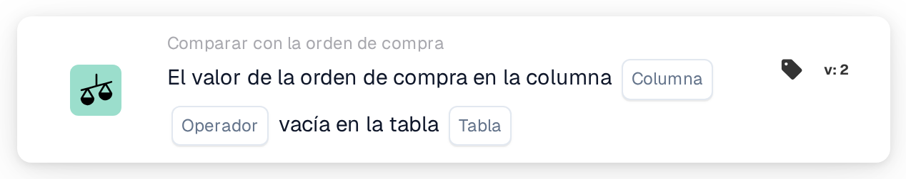

# Columna de la orden de compra vacía

<figure><figcaption>
Versión 2
</figcaption></figure>

## Propósito:

Esta tarjeta de flujo de trabajo comprueba si una columna de los datos de la orden de compra está vacía. Consulta directamente la orden de compra almacenada, sus líneas o sus cargos distribuidos, y puede utilizarse, por ejemplo, para retener documentos cuya orden de compra carece de información de la que dependen pasos posteriores.

## Componentes de la tarjeta:

1. **Columna**
   * **Descripción:** La columna de la orden de compra que se comprueba.
   * **Detalle:** La lista contiene las columnas de la cabecera de la orden de compra, de las líneas de orden de compra y de los cargos distribuidos, por ejemplo **ID del proveedor**, **Precio unitario**, **Cantidad** o **Tipo de cargo**. La columna debería pertenecer a la tabla seleccionada en **Tabla**.
2. **Operador**
   * **Descripción:** Si la columna debería estar vacía o no.
   * **Opciones:**
     * **Es:** La condición se cumple si la columna está vacía en al menos un registro comprobado.
     * **No Es:** La condición se cumple si la columna tiene un valor en todos los registros comprobados.
3. **Tabla**
   * **Descripción:** La tabla de la orden de compra de la que se lee la columna.
   * **Opciones:**
     * **Número de pedido:** La cabecera de la orden de compra (un registro).
     * **Línea de orden de compra:** Todas las líneas de la orden de compra.
     * **Cargo distribuido de orden de compra:** Todos los cargos distribuidos de la orden de compra.

## Funcionalidad:

* **Orden de compra utilizada:** Si la ejecución del flujo de trabajo lleva su propia orden de compra, se comprueba esa orden de compra. En caso contrario, la tarjeta utiliza la orden de compra de la primera línea del documento emparejada o, si no hay ninguna línea emparejada, la primera orden de compra cargada para el documento.
* **Evaluación de la condición:** La tarjeta lee todos los registros de la tabla seleccionada que pertenecen a la orden de compra y comprueba la columna seleccionada en cada uno de ellos. Una columna cuenta como vacía si no tiene valor, si contiene un texto vacío o un valor numérico de 0. Un valor sí/no siempre cuenta como relleno, también cuando es «no».
* **Columna que no está en la tabla:** Si la columna seleccionada no existe en la tabla seleccionada, la tarjeta no informa de ningún error. Con **Es**, la condición se considera cumplida; con **No Es**, no cumplida.
* **Ejecución de la acción:**
  * **Condición verdadera:**\
    Con **Es**, la columna está vacía en al menos un registro; con **No Es**, tiene un valor en todos los registros. El flujo de trabajo continúa.
  * **Condición falsa:**\
    En caso contrario, el flujo de trabajo se detiene con una condición no cumplida.
* **Datos que faltan:** La tarjeta no evalúa la condición e informa de datos faltantes en el registro del flujo de trabajo cuando no hay ninguna orden de compra disponible (ni de la ejecución del flujo de trabajo ni emparejada con el documento), cuando **Columna** o **Tabla** no están definidos, o cuando no existe ningún registro de la tabla seleccionada para la orden de compra.

## Configuración:

* La tarjeta se puede añadir como condición And desde la categoría **Comparar con la orden de compra**. A continuación se pueden seleccionar la **Columna**, el operador y la **Tabla**. Elegir una columna que pertenezca a la tabla seleccionada evita el resultado silencioso descrito anteriormente.
* Para probar la tarjeta con un documento existente, se puede utilizar **Tarjeta de prueba** en el menú de la tarjeta del Workflow Builder.

## Conclusión:

La tarjeta de flujo de trabajo «Purchase Order Column Empty» comprueba la integridad de los propios datos de la orden de compra. Ayuda a detener los documentos de forma temprana cuando a la orden de compra le falta un valor del que dependen la aprobación, la exportación u otros pasos del flujo de trabajo.
