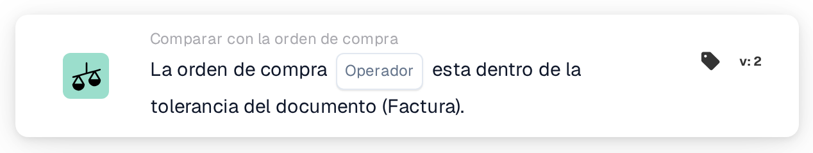

# Coincidencia completa con la orden de compra

<figure><figcaption>
Versión 2
</figcaption></figure>

## Propósito:

Esta tarjeta de flujo de trabajo comprueba si la orden de compra emparejada coincide en su conjunto con el documento dentro de las tolerancias. La cantidad, el precio unitario y los cargos adicionales de cada línea emparejada se comprueban en un solo paso, de modo que una única tarjeta puede decidir si un documento puede procesarse sin revisión manual.

La conciliación de la orden de compra debería ejecutarse antes de esta tarjeta. Sin una orden de compra emparejada, la tarjeta informa de datos faltantes.

## Componentes de la tarjeta:

1. **Operador**
   * **Descripción:** Si la orden de compra debería coincidir completamente con el documento o no.
   * **Opciones:**
     * **Es:** La condición se cumple si todas las comprobaciones están dentro de la tolerancia.
     * **No Es:** La condición se cumple si al menos una comprobación está fuera de la tolerancia.

## Funcionalidad:

* **Evaluación de la condición:** La tarjeta recorre cada línea de orden de compra emparejada (incluidas las sublíneas) y utiliza los datos comparativos que la conciliación de la orden de compra almacenó para ella:
  * **Cantidad:** La cantidad del documento se compara con la cantidad de la orden de compra, dentro de la tolerancia de cantidad de la línea.
  * **Precio unitario:** El precio unitario del documento se compara con el precio unitario de la orden de compra, dentro de la tolerancia de precio unitario de la línea. Cuando la línea no lleva precio unitario en sus datos comparativos, sino solo en su información general de conciliación, la tarjeta utiliza la tolerancia de precio unitario configurada para el tipo de documento en lugar de la tolerancia almacenada en la línea; en ese caso, una tolerancia porcentual se mide a partir del precio de la orden de compra.
  * **Cargos adicionales:** Para cada cargo adicional de la línea, se comparan con la orden de compra la tasa del cargo, el precio unitario y el importe, cada uno dentro de su tolerancia.
  * En los albaranes, que no llevan precios, solo se compara la cantidad.
* Todas las comprobaciones de todas las líneas se combinan: la orden de compra coincide completamente solo si cada una de las comprobaciones está dentro de la tolerancia.
* **Ejecución de la acción:**
  * **Condición verdadera:**\
    Con **Es**, todas las comprobaciones están dentro de la tolerancia; con **No Es**, al menos una no lo está. El flujo de trabajo continúa.
  * **Condición falsa:**\
    En caso contrario, el flujo de trabajo se detiene con una condición no cumplida.
* **Datos que faltan:** La tarjeta no evalúa la condición e informa de datos faltantes en el registro del flujo de trabajo cuando el documento no tiene ninguna orden de compra emparejada, o cuando a una línea emparejada le falta parte de los datos necesarios para sus comprobaciones, por ejemplo una cantidad, un precio unitario, el valor de un cargo adicional o la tolerancia de alguno de ellos (incluida una tolerancia de precio unitario ausente o inutilizable en el tipo de documento, cuando esta es necesaria). Una tolerancia ausente no se trata como una tolerancia de 0. Esto también se aplica con **No Es**: los datos que faltan se notifican como datos faltantes, no como una discrepancia.

## Configuración:

* La tarjeta se puede añadir como condición And después de la conciliación de la orden de compra, desde la categoría **Comparar con la orden de compra**. A continuación se puede seleccionar el operador (**Es** o **No Es**). Las tolerancias en sí no se definen en la tarjeta; proceden de la conciliación de la orden de compra y de los ajustes del tipo de documento.
* Para probar la tarjeta con un documento existente, se puede utilizar **Tarjeta de prueba** en el menú de la tarjeta del Workflow Builder. El registro de la tarjeta enumera cada comparación de cantidad, precio unitario y cargo con los valores del documento y de la orden de compra.

## Conclusión:

La tarjeta de flujo de trabajo «Purchase Order Full Match» resume en una sola condición la comparación de un documento con su orden de compra. Los documentos que coinciden con su orden de compra en todas las líneas pueden pasar automáticamente, mientras que cualquier diferencia fuera de las tolerancias se notifica como condición no cumplida, y los datos comparativos que faltan, como datos faltantes, nunca como coincidencia.
