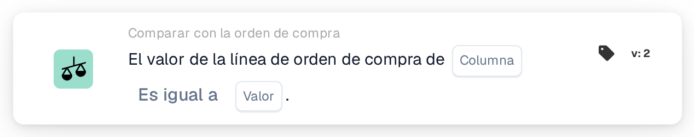

# Valor de la línea de orden de compra

<figure><figcaption>
Versión 2
</figcaption></figure>

## Propósito:

Esta tarjeta de flujo de trabajo compara una columna de las líneas de orden de compra emparejadas con un valor fijo. Puede utilizarse para comprobar una propiedad de las líneas pedidas que no figura impresa en el documento, por ejemplo un estado, un código de unidad o un método de entrega, y tratar el documento en consecuencia.

La conciliación de la orden de compra debería ejecutarse antes de esta tarjeta. Sin una orden de compra emparejada, la tarjeta informa de datos faltantes.

## Componentes de la tarjeta:

1. **Columna**
   * **Descripción:** La columna de la línea de orden de compra cuyo valor se compara.
2. **Operador**
   * **Descripción:** Cómo se compara el valor de la línea de orden de compra con el valor de la tarjeta. El valor predeterminado es **Es igual a**.
   * **Opciones:**
     * **Es igual a:** El valor de la línea es igual al valor. En el caso del texto, no se distingue entre mayúsculas y minúsculas.
     * **No es igual a:** El valor de la línea es distinto del valor. En el caso del texto, sí se distingue entre mayúsculas y minúsculas.
     * **Mayor Que**, **Mayor o igual que**, **Menor que**, **Menos o igual:** Útiles principalmente para columnas numéricas.
     * **Contiene:** El valor de la línea es exactamente una de las entradas de **Valor**, incluidas las mayúsculas y minúsculas. Las coincidencias parciales no cuentan.
     * **No contiene:** El valor de la línea no es ninguna de las entradas de **Valor** (comparado de la misma forma exacta).
3. **Valor**
   * **Descripción:** El valor con el que se compara el valor de la línea de orden de compra.
   * **Detalle:** Con **Contiene** y **No contiene**, se pueden introducir varias entradas, separadas por comas. Con los operadores **Mayor** y **Menor**, no se admite una lista de valores.

## Funcionalidad:

* **Evaluación de la condición:** Para cada línea de orden de compra emparejada (incluidas las sublíneas), la tarjeta lee el valor de la columna seleccionada y lo compara con **Valor** mediante el operador. Si ambos son números, se comparan como números; en caso contrario, como texto.
* Cada línea comparada tiene que cumplir la condición; esta tarjeta no tiene la opción **Cualquiera/Todos**.
* **Ejecución de la acción:**
  * **Condición verdadera:**\
    Si cada línea comparada cumple la condición, el flujo de trabajo continúa.
  * **Condición falsa:**\
    Si al menos una línea no la cumple, el flujo de trabajo se detiene con una condición no cumplida.
* **Datos que faltan:** La tarjeta no evalúa la condición e informa de datos faltantes en el registro del flujo de trabajo cuando **Columna** o **Valor** no están definidos, cuando el documento no tiene ninguna orden de compra emparejada o sus datos no están disponibles, cuando la columna seleccionada de una línea emparejada está vacía (un valor numérico de 0 también cuenta como vacío), o cuando no se ha podido comparar ninguna línea.
* **Error de configuración:** Si **Valor** contiene una coma y está seleccionado uno de los operadores **Mayor** o **Menor**, la tarjeta se detiene con un error de configuración.

## Configuración:

* La tarjeta se puede añadir como condición And después de la conciliación de la orden de compra, desde la categoría **Comparar con la orden de compra**. A continuación se pueden definir la **Columna** de la línea de orden de compra, el operador y el **Valor**. Para comprobar frente a varios valores permitidos, se podría utilizar **Contiene** con una lista separada por comas.
* Para probar la tarjeta con un documento existente, se puede utilizar **Tarjeta de prueba** en el menú de la tarjeta del Workflow Builder. El registro de la tarjeta enumera cada valor de línea comparado con el operador y el valor utilizados.

## Conclusión:

La tarjeta de flujo de trabajo «Purchase Order Line Value» incorpora los datos de las líneas de orden de compra al flujo de trabajo como una condición sencilla. Permite que un flujo de trabajo reaccione a cómo se pidieron los bienes, incluso cuando esa información no aparece en el propio documento.
