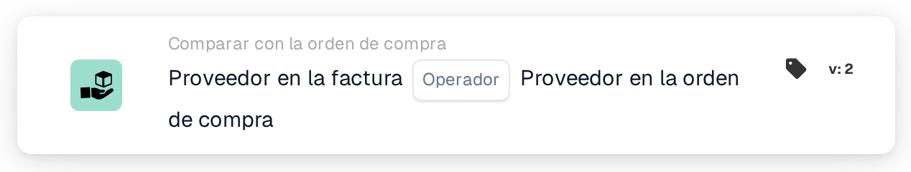

# Proveedor en factura

<figure><figcaption>
Versión 2
</figcaption></figure>

## **Propósito:**

Esta tarjeta de flujo de trabajo está diseñada para comparar la información del proveedor de una factura con la información del proveedor de la orden de compra relacionada. La tarjeta garantiza que el proveedor de la factura coincida con el proveedor de la orden de compra. Esta comparación ayuda a verificar que el proveedor correcto está facturando el pedido y puede disparar acciones según cualquier discrepancia.

## **Componentes de la tarjeta:**

1. **Operador:**
   * **Descripción**: Define la condición para comparar el proveedor de la factura con el proveedor de la orden de compra.
   * **Opciones**:
     * **Is**: Comprueba si el proveedor de la factura coincide con el proveedor de la orden de compra.
     * **no es**: Garantiza que el proveedor de la factura no coincida con el proveedor de la orden de compra.

## **Funcionalidad:**

* **Evaluación de la condición:** El sistema compara el proveedor de la factura con el proveedor de la orden de compra según el operador seleccionado. Si la condición de comparación es verdadera (p. ej., el proveedor es el mismo o diferente según se requiera), el flujo de trabajo continuará en consecuencia.
* **Ejecución de la acción:**
  * **Condición verdadera**: Si la condición se evalúa como verdadera (p. ej., el proveedor de la factura coincide con el proveedor de la orden de compra), el flujo de trabajo continúa sin disparar ningún error.
  * **Condición falsa**: Si la condición se evalúa como falsa (p. ej., el proveedor de la factura no coincide con el proveedor de la orden de compra), el flujo de trabajo no continuará.

## **Configuración:**

* Los usuarios eligen el operador adecuado ("Is" o "Is Not") para definir cómo se compararán los proveedores.

## **Ejemplo de escenario:**

* Una factura indica un proveedor con el ID "SUP123" y la orden de compra relacionada también indica "SUP123" como proveedor. Usando el operador "Is", la tarjeta compara los proveedores y los encuentra iguales, por lo que el flujo de trabajo continúa sin problemas.

## **Conclusión:**

La tarjeta de flujo de trabajo "Supplier Comparison" garantiza que el proveedor correcto esté facturando la orden de compra, ayudando a evitar discrepancias y errores en el proceso de compras. Al verificar automáticamente la información del proveedor, las organizaciones pueden agilizar su proceso de aprobación de facturas y reducir el riesgo de fraude o errores en la facturación de proveedores.
