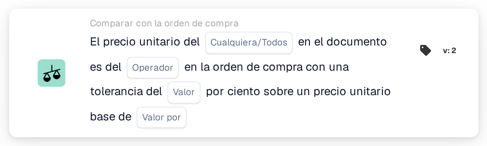

# Tolerancia del precio unitario por precio base

<figure><figcaption>
Versión 2
</figcaption></figure>

## Propósito:

Esta tarjeta de flujo de trabajo compara los precios unitarios del documento con los precios unitarios de las líneas de orden de compra emparejadas, utilizando una tolerancia porcentual que aumenta con el precio de la orden de compra. La tolerancia se introduce como porcentaje por precio unitario base, de modo que los artículos de precio más alto obtienen una tolerancia porcentual mayor que los de precio más bajo.

Para una tolerancia fija, se puede utilizar la tarjeta **Any / All Unit Price is**.

La conciliación de la orden de compra debería ejecutarse antes de esta tarjeta. Sin una orden de compra emparejada, la tarjeta informa de datos faltantes.

## Componentes de la tarjeta:

1. **Cualquiera/Todos**
   * **Descripción:** Cómo se combinan las comparaciones de las líneas individuales en el resultado de la tarjeta.
   * **Opciones:**
     * **Cualquier:** Al menos una línea cumple la comparación.
     * **Todos:** Cada línea comparada cumple la comparación. Si no se ha definido ningún valor, la tarjeta utiliza **Todos**.
2. **Operador**
   * **Descripción:** Cómo se compara el precio unitario del documento con el precio unitario de la orden de compra, teniendo en cuenta la tolerancia.
   * **Opciones:**
     * **Es igual a:** El precio del documento está dentro del rango de tolerancia en torno al precio de la orden de compra.
     * **No es igual a:** El precio del documento está fuera del rango de tolerancia.
     * **Mayor Que:** El precio del documento está por encima del rango de tolerancia.
     * **Mayor o igual que:** El precio del documento está dentro del rango de tolerancia o por encima de él.
     * **Menor que:** El precio del documento está por debajo del rango de tolerancia.
     * **Menos o igual:** El precio del documento está dentro del rango de tolerancia o por debajo de él.
3. **Valor**
   * **Descripción:** La tolerancia en porcentaje que se aplica al precio unitario base.
   * **Detalle:** Un número, por ejemplo `1` para el 1 por ciento.
4. **Valor por**
   * **Descripción:** El precio unitario base al que se refiere el porcentaje de tolerancia.
   * **Detalle:** Un número mayor que 0, por ejemplo `100`.

## Funcionalidad:

* **Cálculo de la tolerancia:** Para cada línea, el porcentaje de tolerancia se escala según la proporción entre el precio unitario de la orden de compra y el precio unitario base:\
  tolerancia % = **Valor** × (precio unitario de la orden de compra ÷ **Valor por**)\
  El rango de tolerancia es el precio unitario de la orden de compra más y menos este porcentaje.\
  Ejemplo con **Valor** 1 y **Valor por** 100: un precio de orden de compra de 50 da una tolerancia del 0,5 %, por lo que el rango va de 49,75 a 50,25. Un precio de orden de compra de 200 da un 2 %, por lo que el rango va de 196 a 204.
* **Evaluación de la condición:** Para cada línea de orden de compra emparejada, el precio unitario del documento se compara con el precio unitario de la línea de orden de compra, utilizando el operador y el rango calculado. Las entradas emparejadas sin línea de orden de compra se omiten. Los resultados se combinan con **Cualquiera/Todos**.
* **Ejecución de la acción:**
  * **Condición verdadera:**\
    Si se cumple el resultado combinado, el flujo de trabajo continúa.
  * **Condición falsa:**\
    Si no se cumple el resultado combinado, el flujo de trabajo se detiene con una condición no cumplida. Esto también ocurre cuando no se ha podido comparar ninguna línea.
* **Datos que faltan:** La tarjeta no evalúa la condición e informa de datos faltantes en el registro del flujo de trabajo cuando **Valor** o **Valor por** no están definidos, cuando el documento no tiene ninguna orden de compra emparejada, o cuando al documento o a la orden de compra les falta el precio unitario de una línea comparada (un precio unitario vacío o un precio unitario numérico de 0 cuenta como ausente).
* **Errores:** La tarjeta se detiene con un error cuando **Valor** o **Valor por** no son un número, cuando un precio unitario no puede leerse como número, cuando **Valor por** es 0, o cuando la tolerancia calculada para una línea es inferior al 0 % o superior al 100 %.

## Configuración:

* La tarjeta se puede añadir como condición And después de la conciliación de la orden de compra, desde la categoría **Comparar con la orden de compra**. A continuación se pueden introducir **Cualquiera/Todos**, el operador, el porcentaje de tolerancia en **Valor** y el precio unitario base en **Valor por**. El precio unitario base debería elegirse de forma que la tolerancia calculada se mantenga entre el 0 % y el 100 % para el rango de precios de los artículos.
* Para probar la tarjeta con un documento existente, se puede utilizar **Tarjeta de prueba** en el menú de la tarjeta del Workflow Builder. El registro de la tarjeta muestra, para cada línea, ambos precios, la tolerancia calculada en porcentaje y el rango resultante.

## Conclusión:

La tarjeta de flujo de trabajo «Unit Price Tolerance per Base Price» aplica una tolerancia dependiente del precio a la comparación del precio unitario con la orden de compra. Así, con una sola tarjeta, se puede aplicar una tolerancia estrecha a los artículos de precio bajo y una más amplia a los de precio alto.
