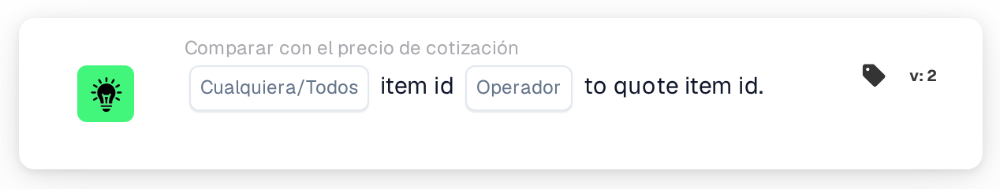

# ID de artículo frente a ID de artículo de la cotización

<figure><figcaption>
Versión 2
</figcaption></figure>

## Propósito:

Esta tarjeta de flujo de trabajo compara el número de artículo de cada línea de un documento con el número de artículo almacenado para el mismo artículo del proveedor en la tabla de precios de artículos del proveedor. Puede utilizarse para detectar líneas en las que el documento indica un artículo distinto del que corresponde a los datos de precios. Según el resultado, el flujo de trabajo continúa con la condición verdadera o con la falsa.

## Componentes de la tarjeta:

1. **Cualquiera/Todos**
   * **Descripción:** Define si una línea o todas las líneas comparadas de la tabla del documento deberían cumplir la condición.
   * **Opciones:**
     * **Cualquier:** La condición es verdadera si al menos una línea comparada cumple la condición.
     * **Todos:** La condición solo es verdadera si todas las líneas comparadas cumplen la condición.
2. **Operador**
   * **Descripción:** Define cómo se compara el número de artículo de la tabla de precios de artículos del proveedor con el número de artículo de la línea del documento.
   * **Opciones:**
     * **Es igual a:** Los números de artículo son iguales. Los números de artículo que pueden leerse ambos como números se comparan como números (por ejemplo, "007" y "7" son iguales); en caso contrario, se comparan como texto sin distinguir entre mayúsculas y minúsculas.
     * **No es igual a:** Los números de artículo son distintos. Los números de artículo que pueden leerse ambos como números se comparan como números; en caso contrario, se comparan como texto y, en este caso, sí se distingue entre mayúsculas y minúsculas.
     * **Mayor Que, Mayor o igual que, Menor que, Menos o igual:** La tarjeta también los ofrece. Con estos operadores, los números de artículo siempre se comparan como texto, carácter por carácter, de modo que, por ejemplo, "10" cuenta como menor que "9".

## Funcionalidad:

* **Evaluación de la condición:** Para cada línea de la tabla del documento, la tarjeta busca el ID de artículo del proveedor de la línea (columna `SUPPLIER_ITEM_NUMBER`) en la tabla de precios de artículos del proveedor y compara el número de artículo almacenado allí con el número de artículo de la línea (columna `ITEM_NUMBER`). A continuación, los resultados de todas las líneas comparadas se combinan con **Cualquier** o **Todos**.
* **Líneas omitidas:** Una línea queda fuera de la comparación si la tabla de precios de artículos del proveedor no tiene ninguna entrada para su ID de artículo del proveedor, o si la entrada no tiene número de artículo. Cada línea omitida se anota en el registro del flujo de trabajo.
* **Fechas de validez:** Si una entrada de la tabla de precios de artículos del proveedor tiene una fecha de inicio o de fin y la fecha del documento queda fuera de ese periodo, la tarjeta lo anota en el registro del flujo de trabajo. Esta nota no cambia el resultado de la tarjeta.
* **Ejecución de la acción:**
  * **Condición verdadera:**\
    Los números de artículo cumplen el operador seleccionado para alguna o todas las líneas comparadas. El flujo de trabajo continúa con la condición verdadera.
  * **Condición falsa:**\
    Si no se cumple la condición, el flujo de trabajo continúa con la condición falsa, por ejemplo para enviar el documento a una revisión manual. La condición falsa también se utiliza si no se ha podido comparar ninguna de las líneas, porque ninguna línea tenía número de artículo en la tabla de precios de artículos del proveedor.
* **Datos que faltan:** Si el documento no tiene ninguna tabla, tiene más de una tabla o no se ha podido leer ninguna línea de la tabla, la tarjeta no evalúa la condición y registra los datos que faltan en el registro del flujo de trabajo. Si no se ha definido ninguna opción de **Cualquiera/Todos**, la tarjeta lo anota en el registro y utiliza **Todos**.

## Configuración:

* La tarjeta se puede añadir desde la categoría **Comparar con el precio de cotización**. A continuación se pueden seleccionar **Cualquier** o **Todos** y el operador. Para comprobar si los números de artículo coinciden, lo habitual es elegir **Es igual a** o **No es igual a**. Por último se define la condición de continuación (verdadera o falsa), que determina el siguiente paso del flujo de trabajo.
* La tarjeta trabaja con documentos que tienen exactamente una tabla, cuyas líneas llevan el ID de artículo del proveedor y el número de artículo.

## Conclusión:

La tarjeta de flujo de trabajo «Item ID to Quote Item ID» garantiza que los artículos de un documento coincidan con los artículos a los que se refiere la tabla de precios de artículos del proveedor. Las líneas sin datos de precios se omiten en lugar de contarse como diferencias, de modo que el resultado solo refleja las líneas que realmente pueden compararse.
