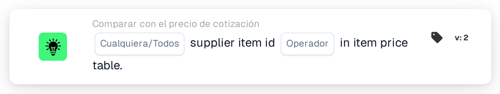

# ID de artículo del proveedor en la tabla de precios de artículos

<figure><figcaption>
Versión 2
</figcaption></figure>

## Propósito:

Esta tarjeta de flujo de trabajo comprueba si los ID de artículo del proveedor de las líneas de un documento se encuentran en la tabla de precios de artículos del proveedor. Puede utilizarse para averiguar si DocBits dispone de datos de precios para los artículos de una cotización, para el proveedor del documento, antes de que se ejecuten otras comparaciones de cotización, o para dirigir los documentos con artículos desconocidos a una comprobación manual. Según el resultado, el flujo de trabajo continúa con la condición verdadera o con la falsa.

## Componentes de la tarjeta:

1. **Cualquiera/Todos**
   * **Descripción:** Define si una línea o todas las líneas de la tabla del documento deberían cumplir la condición.
   * **Opciones:**
     * **Cualquier:** La condición es verdadera si al menos una línea cumple la condición.
     * **Todos:** La condición solo es verdadera si todas las líneas cumplen la condición.
2. **Operador**
   * **Descripción:** Define si el ID de artículo del proveedor debería encontrarse en la tabla de precios de artículos del proveedor o no.
   * **Opciones:**
     * **Es:** Una línea cumple la condición si su ID de artículo del proveedor está en la tabla de precios de artículos del proveedor.
     * **No Es:** Una línea cumple la condición si su ID de artículo del proveedor no está en la tabla de precios de artículos del proveedor.

## Funcionalidad:

* **Evaluación de la condición:** La tarjeta lee el ID de artículo del proveedor (columna `SUPPLIER_ITEM_NUMBER`) de cada línea de la tabla del documento y comprueba si la tabla de precios de artículos del proveedor contiene una entrada para él. A continuación, los resultados de todas las líneas se combinan con **Cualquier** o **Todos**.
* **Fechas de validez:** Si una entrada de la tabla de precios de artículos del proveedor tiene una fecha de inicio o de fin y la fecha del documento queda fuera de ese periodo, la tarjeta lo anota en el registro del flujo de trabajo. Esta nota no cambia el resultado de la tarjeta.
* **Ejecución de la acción:**
  * **Condición verdadera:**\
    Con **Es**, los ID de artículo del proveedor (alguno o todos, según lo seleccionado) están en la tabla de precios de artículos del proveedor. Con **No Es**, no lo están. El flujo de trabajo continúa con la condición verdadera, por ejemplo para seguir con la comparación de precios.
  * **Condición falsa:**\
    Si no se cumple la condición, el flujo de trabajo continúa con la condición falsa, por ejemplo para enviar el documento a una revisión manual.
* **Datos que faltan:** Si el documento no tiene ninguna tabla, tiene más de una tabla, no se ha podido leer ninguna línea de la tabla o el documento no tiene ningún dato de precios de artículos del proveedor, la tarjeta no evalúa la condición y registra los datos que faltan en el registro del flujo de trabajo. Si no se ha definido ninguna opción de **Cualquiera/Todos**, la tarjeta lo anota en el registro y utiliza **Todos**.
* **Errores:** La tarjeta termina con un error si una línea de la tabla no tiene la columna `SUPPLIER_ITEM_NUMBER`. Si no se ha definido ningún operador, la tarjeta registra un error de configuración.

## Configuración:

* La tarjeta se puede añadir desde la categoría **Comparar con el precio de cotización**. A continuación se pueden seleccionar **Cualquier** o **Todos** y el operador (**Es** o **No Es**). Por último se define la condición de continuación (verdadera o falsa), que determina el siguiente paso del flujo de trabajo.
* La tarjeta trabaja con documentos que tienen exactamente una tabla, cuyas líneas llevan el ID de artículo del proveedor.

## Conclusión:

La tarjeta de flujo de trabajo «Supplier Item ID in Item Price Table» muestra si los artículos de un documento son conocidos en la tabla de precios de artículos del proveedor. Puede servir como primera comprobación en un flujo de trabajo de cotizaciones, de modo que las comparaciones posteriores de precio, número de artículo y unidad de medida solo se ejecuten para documentos cuyos artículos tienen datos de precios.
