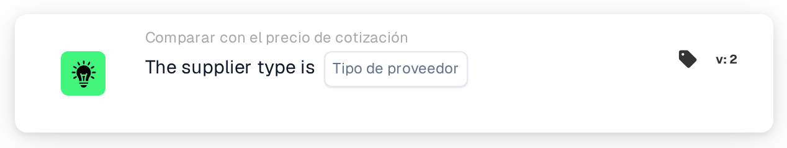

# Tipo de proveedor

<figure><figcaption>
Versión 2
</figcaption></figure>

## Propósito:

Esta tarjeta de flujo de trabajo comprueba el tipo de proveedor de los artículos en los datos de precios de artículos del proveedor de un documento, por ejemplo si los artículos son artículos de contrato o artículos gestionados. Puede utilizarse para aplicar reglas de aprobación distintas según cómo se gestionen los artículos del proveedor. Según el resultado, el flujo de trabajo continúa con la condición verdadera o con la falsa.

## Componentes de la tarjeta:

1. **Tipo de proveedor**
   * **Descripción:** El tipo de proveedor con el que se comprueba el documento.
   * **Opciones:**
     * **Contract:** Coincide con las entradas cuya clase de gestión es "contract".
     * **Managed:** Coincide con las entradas cuya clase de gestión es "managed".
     * **NonManaged:** Coincide con las entradas cuya clase de gestión es "unmanaged".

## Funcionalidad:

* **Evaluación de la condición:** La tarjeta lee el tipo de proveedor (clase de gestión) de cada entrada de los datos de precios de artículos del proveedor del documento y lo compara con el tipo de proveedor seleccionado en la tarjeta. La comparación no distingue entre mayúsculas y minúsculas.
* **Ejecución de la acción:**
  * **Condición verdadera:**\
    Todas las entradas de los datos de precios de artículos del proveedor tienen el tipo de proveedor seleccionado. El flujo de trabajo continúa con la condición verdadera, por ejemplo para aplicar las reglas de este tipo de proveedor.
  * **Condición falsa:**\
    Si al menos una entrada tiene un tipo de proveedor distinto o no tiene clase de gestión, el flujo de trabajo continúa con la condición falsa.
* **Datos que faltan:** Si no hay ningún tipo de proveedor seleccionado en la tarjeta, o el documento no tiene datos de precios de artículos del proveedor, la tarjeta no evalúa la condición y registra los datos que faltan en el registro del flujo de trabajo.

## Configuración:

* La tarjeta se puede añadir desde la categoría **Comparar con el precio de cotización**. A continuación se puede seleccionar el tipo de proveedor en el campo **Tipo de proveedor**. Por último se define la condición de continuación (verdadera o falsa), que determina el siguiente paso del flujo de trabajo.

## Conclusión:

La tarjeta de flujo de trabajo «Supplier Type» permite que un flujo de trabajo de cotizaciones se bifurque según el tipo de proveedor de los artículos, de modo que los artículos de contrato, los gestionados y los no gestionados puedan tratarse cada uno con sus propias reglas.
