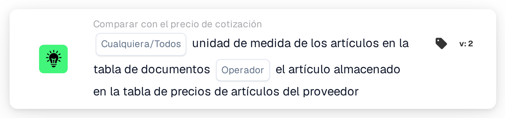
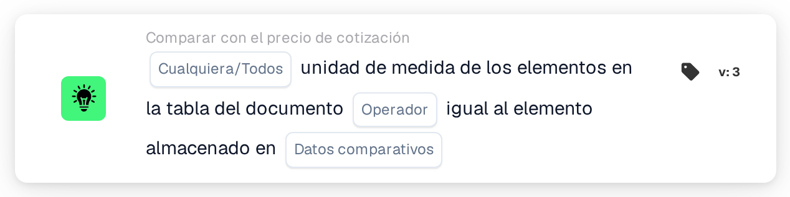

# Unidad de medida

<figure><figcaption>
Versión 2
</figcaption></figure>

<figure><figcaption>
Versión 3
</figcaption></figure>

## Propósito:

Esta tarjeta de flujo de trabajo compara la unidad de medida de los artículos de la tabla del documento con la unidad de medida almacenada en otro lugar para los mismos artículos. En la versión 2, la comparación se realiza siempre con la tabla de precios de artículos del proveedor. La versión 3 añade la posibilidad de elegir entre la tabla de precios de artículos del proveedor y las líneas de artículo de la orden de compra emparejada. La tarjeta puede utilizarse para detectar líneas en las que un artículo se cotiza o se factura en una unidad distinta de la esperada. Según el resultado, el flujo de trabajo continúa con la condición verdadera o con la falsa.

## Componentes de la tarjeta:

1. **Cualquiera/Todos**
   * **Descripción:** Define si una línea o todas las líneas comparadas de la tabla del documento deberían cumplir la condición.
   * **Opciones:**
     * **Cualquier:** La condición es verdadera si al menos una línea comparada cumple la condición.
     * **Todos:** La condición solo es verdadera si todas las líneas comparadas cumplen la condición.
2. **Operador**
   * **Descripción:** Define si las unidades de medida deberían ser iguales o distintas.
   * **Opciones:**
     * **Es igual a:** La unidad de medida de la línea del documento es igual a la almacenada.
     * **No es igual a:** La unidad de medida de la línea del documento es distinta de la almacenada.
3. **Datos comparativos** (solo versión 3)
   * **Descripción:** La fuente con la que se compara la unidad de medida del documento.
   * **Opciones:**
     * **precio del artículo cotizado por el proveedor:** La unidad de medida almacenada para el artículo del proveedor en la tabla de precios de artículos del proveedor, como en la versión 2.
     * **línea de artículo de la orden de compra:** La unidad de medida de la línea de orden de compra emparejada.

## Funcionalidad:

* **Evaluación de la condición:** La tarjeta lee la unidad de medida (columna `UNIT`) de las líneas de la primera tabla del documento y la compara con la fuente seleccionada. La comparación no distingue entre mayúsculas y minúsculas. A continuación, los resultados de todas las líneas comparadas se combinan con **Cualquier** o **Todos**.
  * **precio del artículo cotizado por el proveedor:** Solo se comparan las líneas vinculadas a una entrada de los datos de cotización emparejados. Para cada una de estas líneas, se utiliza la unidad de medida almacenada para su artículo del proveedor.
  * **línea de artículo de la orden de compra** (versión 3): Solo se comparan las líneas emparejadas con una línea de orden de compra. La unidad de medida de la línea de orden de compra se traduce primero con la tabla de búsqueda de unidades de medida (de la unidad EDI a la unidad M3). En ambos lados, algunas grafías se tratan como iguales: "each" como "ea", y "lbs" y "lbp" como "lb".
* **Líneas omitidas:** Una línea queda fuera de la comparación si la fuente no tiene unidad de medida para ella. Cada línea omitida se anota en el registro del flujo de trabajo.
* **Ejecución de la acción:**
  * **Condición verdadera:**\
    Las unidades de medida cumplen el operador seleccionado para alguna o todas las líneas comparadas. El flujo de trabajo continúa con la condición verdadera.
  * **Condición falsa:**\
    Si no se cumple la condición, el flujo de trabajo continúa con la condición falsa, por ejemplo para enviar el documento a una revisión manual. La condición falsa también se utiliza si no se ha podido vincular ninguna línea con la fuente seleccionada y, en la versión 3, si no hay ninguna opción de **Datos comparativos** seleccionada, porque entonces no se compara ninguna línea.
* **Datos que faltan:** La tarjeta no evalúa la condición y registra los datos que faltan en el registro del flujo de trabajo si:
  * el documento no tiene ninguna tabla,
  * se utiliza **precio del artículo cotizado por el proveedor** (o la versión 2) y el documento no tiene datos de cotización emparejados ni datos de precios de artículos del proveedor,
  * está seleccionada **línea de artículo de la orden de compra** y el documento no tiene ninguna orden de compra emparejada,
  * una línea comparada tiene una unidad de medida vacía en el documento,
  * no se ha podido comparar ninguna de las líneas porque se han omitido todas.

  Si no se ha definido ninguna opción de **Cualquiera/Todos**, la tarjeta lo anota en el registro y utiliza **Todos**.
* **Errores:** Con **línea de artículo de la orden de compra**, si una línea de orden de compra se divide en sublíneas con distintas unidades de medida, la tarjeta termina con un error.

## Configuración:

* La tarjeta se puede añadir desde la categoría **Comparar con el precio de cotización**. A continuación se pueden seleccionar **Cualquier** o **Todos** y el operador. En la versión 3, también se puede seleccionar en el campo **Datos comparativos** la fuente con la que se compara. Por último se define la condición de continuación (verdadera o falsa), que determina el siguiente paso del flujo de trabajo.
* La tabla del documento debería contener una columna `UNIT`. Para la comparación con las líneas de artículo de la orden de compra, la tabla de búsqueda de unidades de medida debería contener las correspondencias entre las unidades utilizadas en los documentos y en las órdenes de compra.

## Conclusión:

La tarjeta de flujo de trabajo «Unit of Measure» garantiza que los artículos se coticen o facturen en la unidad esperada. Las líneas sin unidad de medida almacenada se omiten en lugar de contarse como diferencias, y la versión 3 amplía la comprobación de la tabla de precios de artículos del proveedor a las líneas de orden de compra.
