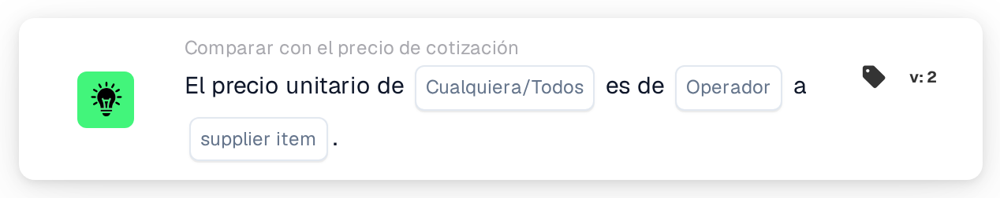

# Precio unitario frente a precio de artículo del proveedor

<figure><figcaption>
Versión 2
</figcaption></figure>

## Propósito:

Esta tarjeta de flujo de trabajo compara el precio unitario de cada línea de un documento con un precio de la tabla de precios de artículos del proveedor, ya sea el precio gestionado o el último precio pagado por el mismo artículo del proveedor. Puede utilizarse para comprobar si un precio cotizado coincide con el precio conocido, lo supera o se mantiene por debajo de él antes de aprobar el documento. Según el resultado, el flujo de trabajo continúa con la condición verdadera o con la falsa.

## Componentes de la tarjeta:

1. **Cualquiera/Todos**
   * **Descripción:** Define si una línea o todas las líneas comparadas de la tabla del documento deberían cumplir la condición.
   * **Opciones:**
     * **Cualquier:** La condición es verdadera si al menos una línea comparada cumple la condición.
     * **Todos:** La condición solo es verdadera si todas las líneas comparadas cumplen la condición.
2. **Operador**
   * **Descripción:** Define cómo se compara el precio unitario del documento con el precio de artículo del proveedor seleccionado.
   * **Opciones:**
     * **Es igual a:** El precio unitario es igual al precio de artículo del proveedor.
     * **No es igual a:** El precio unitario es distinto del precio de artículo del proveedor.
     * **Mayor Que:** El precio unitario es superior al precio de artículo del proveedor.
     * **Mayor o igual que:** El precio unitario es superior o igual al precio de artículo del proveedor.
     * **Menor que:** El precio unitario es inferior al precio de artículo del proveedor.
     * **Menos o igual:** El precio unitario es inferior o igual al precio de artículo del proveedor.
3. **supplier item**
   * **Descripción:** El precio de la tabla de precios de artículos del proveedor con el que se compara el precio unitario.
   * **Opciones:**
     * **ManagedPrice:** El precio gestionado almacenado para el artículo del proveedor.
     * **LastPrice:** El último precio pagado por el artículo del proveedor.

## Funcionalidad:

* **Evaluación de la condición:** Para cada línea de la tabla del documento, la tarjeta busca el ID de artículo del proveedor de la línea (columna `SUPPLIER_ITEM_NUMBER`) en la tabla de precios de artículos del proveedor y compara el precio unitario de la línea (columna `UNIT_PRICE`) con el precio seleccionado. Ambos precios se comparan como números. A continuación, los resultados de todas las líneas comparadas se combinan con **Cualquier** o **Todos**.
* **Líneas omitidas:** Una línea queda fuera de la comparación si su precio unitario está vacío o no puede leerse como número, o si no hay ningún precio del tipo seleccionado almacenado para su artículo del proveedor, por ejemplo porque el artículo del proveedor no está en la tabla de precios de artículos del proveedor. Cada línea omitida se anota en el registro del flujo de trabajo, junto con el lado que no tenía precio.
* **Ejecución de la acción:**
  * **Condición verdadera:**\
    Los precios unitarios cumplen el operador seleccionado para alguna o todas las líneas comparadas. El flujo de trabajo continúa con la condición verdadera, por ejemplo para aprobar el documento.
  * **Condición falsa:**\
    Si no se cumple la condición, el flujo de trabajo continúa con la condición falsa, por ejemplo para enviar el documento a una revisión de precios.
* **Datos que faltan:** La tarjeta no evalúa la condición y registra los datos que faltan en el registro del flujo de trabajo si:
  * no hay ningún precio de artículo del proveedor seleccionado en la tarjeta,
  * el documento no tiene datos de cotización emparejados,
  * el documento no tiene ninguna tabla, tiene más de una tabla o no se ha podido leer ninguna línea de la tabla,
  * no se ha podido comparar ninguna de las líneas porque se han omitido todas.

  Si no se ha definido ninguna opción de **Cualquiera/Todos**, la tarjeta lo anota en el registro y utiliza **Todos**.
* **Errores:** Si una línea de la tabla no tiene la columna `SUPPLIER_ITEM_NUMBER` o la columna `UNIT_PRICE`, la tarjeta termina con un error.

## Configuración:

* La tarjeta se puede añadir desde la categoría **Comparar con el precio de cotización**. A continuación se pueden seleccionar **Cualquier** o **Todos**, el operador y, en el campo **supplier item**, el precio con el que se compara. Por último se define la condición de continuación (verdadera o falsa), que determina el siguiente paso del flujo de trabajo.
* La tarjeta trabaja con documentos que tienen exactamente una tabla, cuyas líneas llevan el ID de artículo del proveedor y el precio unitario.

## Conclusión:

La tarjeta de flujo de trabajo «Unit Price to Supplier Item Price» comprueba los precios cotizados frente al precio gestionado o al último precio pagado. Las líneas sin precio en alguno de los dos lados se omiten, de modo que una sola línea incompleta no decide el resultado, y un documento sin ninguna línea comparable se notifica como datos faltantes.
