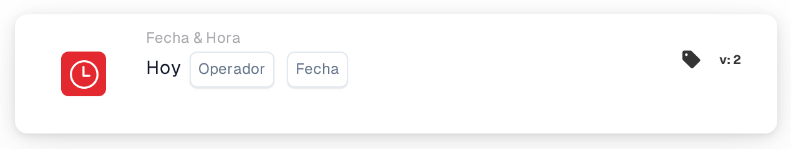

# hoy

<figure><figcaption>
Versión 2
</figcaption></figure>

## Propósito:

Esta tarjeta de flujo de trabajo compara la fecha de hoy con una fecha establecida en la tarjeta. Se puede utilizar para reglas que solo deberían aplicarse a partir de una fecha determinada o hasta ella, por ejemplo un cambio de proceso a partir de una fecha de inicio prevista.

## Componentes de la tarjeta:

1. **Operador**
   * **Descripción:** Cómo se compara la fecha de hoy con la fecha de la tarjeta.
   * **Opciones:**
     * **Es igual a:** Hoy es la fecha de la tarjeta.
     * **No es igual a:** Hoy es cualquier otro día.
     * **Mayor Que:** Hoy es posterior a la fecha de la tarjeta.
     * **Mayor o igual que:** Hoy es la fecha de la tarjeta o una posterior.
     * **Menor que:** Hoy es anterior a la fecha de la tarjeta.
     * **Menos o igual:** Hoy es la fecha de la tarjeta o una anterior.
2. **Fecha**
   * **Descripción:** La fecha con la que se compara hoy.

## Funcionalidad:

* **Evaluación de la condición:** Cuando el flujo de trabajo llega a la tarjeta, esta toma la fecha actual en UTC y la compara con la fecha de la tarjeta mediante el operador. Solo se comparan las fechas; las horas del día se ignoran. Las fechas del documento no intervienen.
* **Ejecución de la acción:**
  * **Condición verdadera:**\
    Si la comparación es verdadera, el flujo de trabajo continúa con las siguientes tarjetas.
  * **Condición falsa:**\
    Si no lo es, el flujo de trabajo se detiene con una condición no cumplida.
* **Datos que faltan:** Si no hay ninguna fecha establecida en la tarjeta, la tarjeta no evalúa la condición e informa de la entrada que falta en el registro del flujo de trabajo.

## Configuración:

* La tarjeta se puede añadir como condición And desde la categoría **Fecha & Hora**. A continuación se seleccionan un operador y una fecha.
* **Ejemplo:** Con **Mayor o igual que** y `2026-11-01`, la tarjeta se cumple a partir del 1 de noviembre de 2026 (UTC) y no se cumple el 31 de octubre de 2026.
* Como la fecha se toma en UTC, puede diferir de la fecha local en torno a la medianoche: en Europa, poco después de la medianoche la tarjeta todavía ve el día anterior; en América, por la noche ya ve el día siguiente.

## Conclusión:

La tarjeta de flujo de trabajo «Today» convierte la fecha del calendario en una condición del flujo de trabajo. Las reglas basadas en fechas, como una fecha de inicio o de fin de un proceso, se pueden configurar una sola vez y se aplican automáticamente.
