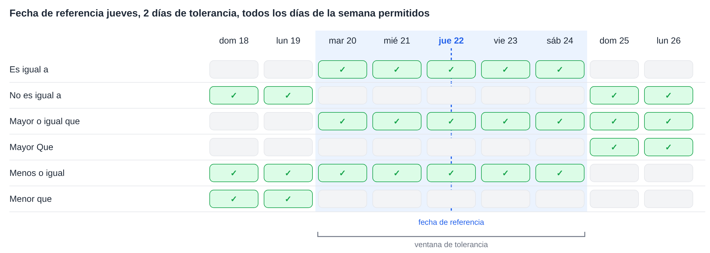
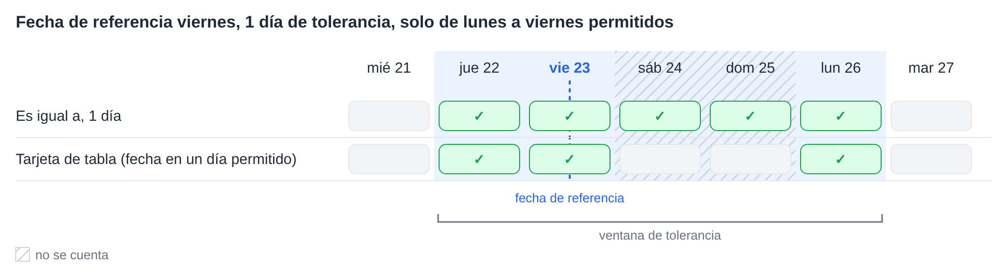
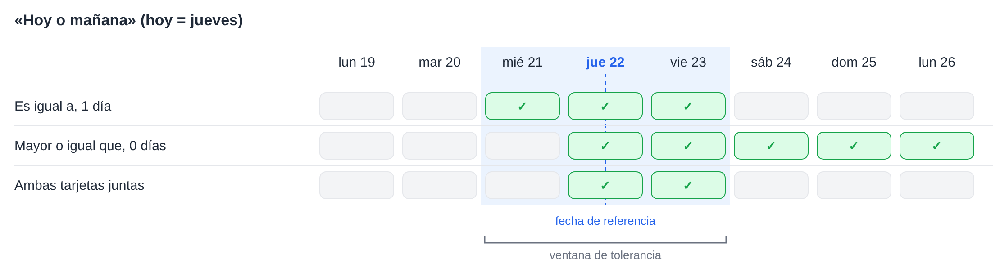

# Tolerancias de fecha

Varias tarjetas de flujo de trabajo comparan una fecha con una fecha de referencia y admiten una tolerancia de un número de días. Todas calculan la tolerancia de la misma forma. Esta página explica ese cálculo, qué significa cada operador, cómo funcionan los **Días de tolerancia permitidos** y cómo combinar dos tarjetas para rangos como «hoy o mañana».

Las tarjetas que utilizan este cálculo:

* [Table Date to Current Date](table/table-date-to-current-date.md): una fecha de una tabla del documento comparada con la fecha actual.
* [Promised delivery date for line items in table with promised delivery date](compare-with-purchase-order/promised-delivery-date-for-line-items-in-table-with-promised-delivery-date/README.md): las fechas de entrega prometidas de las líneas de artículo comparadas con la fecha actual.
* [Promised Delivery Date on Purchase Order](compare-with-purchase-order/promised-delivery-date-on-purchase-order.md): las fechas de entrega de las líneas de artículo comparadas con la fecha de entrega de la orden de compra.

## La ventana de tolerancia

A partir de la fecha de referencia, la tolerancia se cuenta hacia atrás y hacia delante. El resultado es una **ventana de tolerancia**: desde la fecha de inicio hasta la fecha de fin, ambas incluidas.

* Con una tolerancia de **0 días**, la ventana es únicamente la propia fecha de referencia.
* Con una tolerancia de **2 días**, la ventana abarca 2 días antes y 2 días después de la fecha de referencia.
* La **fecha actual** es la fecha de los servidores de DocBits, que funcionan en **UTC**.

Cada operador compara la fecha con esta ventana:

| Operador | Verdadero cuando la fecha está … |
|---|---|
| **Es igual a** | dentro de la ventana |
| **No es igual a** | fuera de la ventana |
| **Mayor o igual que** | en el **inicio** de la ventana o después |
| **Mayor Que** | después del **fin** de la ventana |
| **Menos o igual** | en el **fin** de la ventana o antes |
| **Menor que** | antes del **inicio** de la ventana |

Cabe señalar que la tolerancia también amplía **Mayor o igual que** y **Menos o igual**: con 2 días, **Mayor o igual que** ya acepta una fecha 2 días anterior a la fecha de referencia.

<figure><figcaption>
Fecha de referencia jueves 22, 2 días de tolerancia: la ventana va del martes 20 al sábado 24.
</figcaption></figure>

## Días de tolerancia permitidos

Las tarjetas que ofrecen **Días de tolerancia permitidos** solo cuentan los días de la semana seleccionados al calcular la ventana. Los días de la semana no seleccionados se saltan al contar, pero quedan dentro de la ventana.

**Ejemplo:** fecha de referencia viernes, 1 día de tolerancia, solo de lunes a viernes seleccionados. Al contar hacia atrás se llega al jueves. Al contar hacia delante se saltan el sábado y el domingo y se llega al lunes. La ventana va **del jueves al lunes**.

**Table Date to Current Date** añade una comprobación más: la fecha de la tabla también tiene que caer en uno de los días de la semana seleccionados. Por tanto, esta tarjeta no acepta un sábado que esté dentro de la ventana. Las otras dos tarjetas no tienen esta comprobación adicional.

<figure><figcaption>
Solo se cuentan los días de lunes a viernes, por lo que 1 día después del viernes es el lunes.
</figcaption></figure>

## Ejemplo: hoy o mañana

Una sola tarjeta no puede aceptar exactamente «hoy o mañana», porque la ventana siempre abarca el mismo número de días en ambas direcciones. Dos tarjetas, una tras otra, sí pueden:

1. **Es igual a** con **1 día** de tolerancia acepta ayer, hoy y mañana.
2. **Mayor o igual que** con **0 días** de tolerancia acepta hoy y todos los días posteriores.

Solo quedan las fechas que superan ambas tarjetas: **hoy y mañana**.

<figure><figcaption>
Hoy es jueves 22: juntas, las dos tarjetas aceptan el jueves 22 y el viernes 23.
</figcaption></figure>

Del mismo modo se pueden crear otros rangos:

| Rango | Primera tarjeta | Segunda tarjeta |
|---|---|---|
| Hoy o mañana | **Es igual a**, 1 día | **Mayor o igual que**, 0 días |
| Ayer u hoy | **Es igual a**, 1 día | **Menos o igual**, 0 días |
| Desde hoy hasta 3 días después | **Es igual a**, 3 días | **Mayor o igual que**, 0 días |
| Cualquier día excepto hoy | **No es igual a**, 0 días | – |
| A partir de pasado mañana | **Mayor Que**, 1 día | – |

Cuando solo se seleccionan los días de lunes a viernes como **Días de tolerancia permitidos**, «mañana» en un viernes es el lunes siguiente.

## Conclusión

Todas las tarjetas de fecha con tolerancia utilizan una ventana en torno a la fecha de referencia. Saber dónde empieza y dónde termina la ventana deja claro qué acepta cada operador, y dos tarjetas juntas pueden cubrir rangos que una sola tarjeta no puede.
