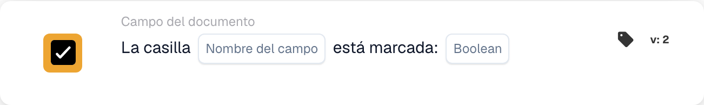
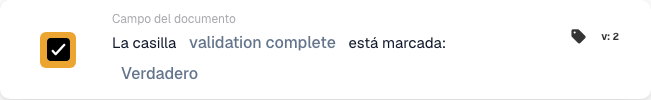

# La casilla de verificación está marcada

## Cuándo y dónde utilizarla

Utilice esta condición cuando una acción posterior dependa de una casilla de verificación del documento. Por ejemplo, permita continuar una factura únicamente cuando su indicador de revisión esté marcado.

En el diseñador de flujos de trabajo, añada la tarjeta en **Y… → Campo del documento**. La tarjeta compara el valor del campo al ejecutarse el flujo; no supervisa continuamente un campo del ERP ni modifica la casilla.

## Requisitos

El tipo de documento debe disponer de un campo booleano para la casilla. Utilice su identificador técnico exacto. En este ejemplo se usa `validation_complete`; sustitúyalo por el campo correspondiente de su organización.

## Configurar la tarjeta

1. Seleccione **La casilla … está marcada** dentro de **Campo del documento**.
2. En **Nombre del campo**, introduzca `validation_complete` y confirme el valor.
3. En **Boolean**, seleccione **Verdadero** para exigir una casilla marcada. Seleccione **Falso** si desea comprobar que no está marcada.

<figure><figcaption>
Tarjeta de condición de casilla en español, antes de seleccionar el campo y el valor booleano.
</figcaption></figure>

## Ejemplo práctico: continuar después de una revisión

**Cuándo utilizarla:** una factura requiere una revisión previa y el proceso deja constancia de ella en `validation_complete`.

**Dónde colocarla:** en las condiciones **Y…**, antes de la acción de seguimiento configurada en **Entonces…**. La acción posterior y el evento que inicia el flujo se configuran por separado.

**Configuración del ejemplo:** campo `validation_complete`, comparación **Verdadero** (`true`), tarjeta versión 2.

<figure><figcaption>
Configuración del ejemplo, versión 2: campo validation complete y comparación Verdadero.
</figcaption></figure>

Los resultados esperados para esta configuración son:

| Valor del campo en el documento | Resultado de la condición |
| --- | --- |
| Casilla existente y marcada (`true`) | La condición se cumple. |
| Casilla existente y sin marcar (`false`) | La condición no se cumple. |
| Casilla existente con valor vacío (`None`) | Se interpreta como no marcada; la condición no se cumple. |
| El campo no existe en el documento | Resultado `NOT_FOUND_IN_DOCUMENT`; no equivale a una casilla existente sin marcar. |

Si selecciona **Falso**, una casilla existente sin marcar cumple la condición y una marcada no la cumple. Un campo ausente sigue siendo un error distinto.

## Comprobar antes de activar

Compruebe que el campo seleccionado es booleano y que corresponde al tipo de documento utilizado. Pruebe un documento con la casilla marcada, otro sin marcar y el caso de un campo ausente. Revise el resultado de la tarjeta y el recorrido posterior del flujo en cada caso.

La tarjeta comprueba el estado de la casilla; el proceso anterior debe establecer el indicador de revisión. Marcarla automáticamente sin efectuar la revisión no demuestra que esta se haya completado.
