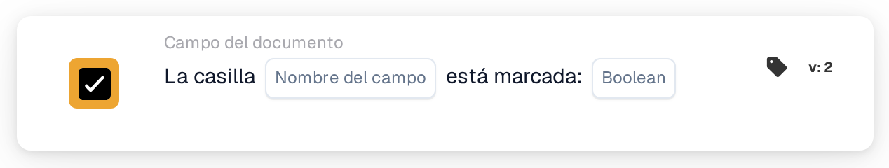

# La casilla de verificación está marcada

<figure><figcaption>
Versión 2
</figcaption></figure>

## Propósito:

Esta tarjeta de flujo de trabajo comprueba si un campo de casilla de verificación del documento está marcado o desmarcado. Se puede utilizar para que un flujo de trabajo continúe solo después de que se haya establecido un indicador en el documento, por ejemplo un indicador de revisión.

## Componentes de la tarjeta:

1. **Nombre del campo**
   * **Descripción:** El nombre técnico del campo de casilla de verificación del documento.
   * **Detalle:** El campo debería ser un campo de casilla de verificación (booleano) del tipo de documento.
2. **Booleano**
   * **Descripción:** El estado que debería tener la casilla de verificación.
   * **Opciones:**
     * **Verdadero:** La casilla de verificación debería estar marcada.
     * **Falso:** La casilla de verificación debería estar desmarcada.

## Funcionalidad:

* **Evaluación de la condición:** Cuando el flujo de trabajo llega a la tarjeta, esta lee el valor actual del campo en el documento y lo compara con **Booleano**. La tarjeta no vigila el campo a lo largo del tiempo y no lo modifica.
  * Un valor de casilla de verificación vacío cuenta como desmarcado.
  * Si no se ha seleccionado ningún valor en **Booleano**, la tarjeta comprueba si la casilla de verificación está desmarcada.
  * Si el campo no es un campo de casilla de verificación, la tarjeta lo indica en el registro del flujo de trabajo y aun así compara su valor.
* **Ejecución de la acción:**
  * **Condición verdadera:**\
    Si el estado de la casilla de verificación coincide con **Booleano**, el flujo de trabajo continúa con las siguientes tarjetas.
  * **Condición falsa:**\
    Si no coincide, el flujo de trabajo se detiene con una condición no cumplida.
* **Datos que faltan:** Si el campo no existe en el documento, la tarjeta no evalúa la condición. Informa de que el campo no se ha encontrado en el documento, lo que es un resultado distinto de una casilla de verificación desmarcada.

## Configuración:

* La tarjeta se puede añadir como condición And desde la categoría **Campo del documento**. A continuación se introduce el nombre técnico del campo de casilla de verificación en **Nombre del campo** y se selecciona **Verdadero** o **Falso**.
* Para comprobar la configuración, se puede utilizar **Tarjeta de prueba** en el menú de la tarjeta del Workflow Builder con un documento con la casilla marcada, otro con la casilla desmarcada y otro sin el campo.

## Conclusión:

La tarjeta de flujo de trabajo «Checkbox is checked» convierte una casilla de verificación del documento en una condición del flujo de trabajo. Así, un flujo de trabajo puede esperar a un paso manual, como una revisión completada, antes de que se ejecuten las acciones siguientes.
