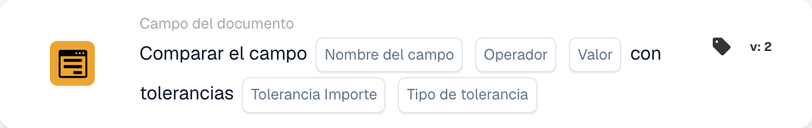

# Comparar campo con tolerancias

<figure><figcaption>
Campos de la tarjeta en la versión mostrada. Los campos aún no están configurados.
</figcaption></figure>

## **Propósito:**

Esta tarjeta de flujo de trabajo está diseñada para comparar el valor de un campo con un valor de referencia especificado, permitiendo tolerancias. Posibilita un procesamiento condicional preciso en flujos de trabajo donde se aceptan pequeñas desviaciones, lo que la hace ideal para escenarios como el control de calidad, el análisis financiero o las acciones basadas en umbrales.

## **Componentes de la tarjeta:**

1. **Nombre de campo**
   * **Descripción:** El campo que se evaluará en la comparación.
   * **Detalle:** Debe coincidir con el identificador exacto del primer campo dentro del documento.
2. **Operador de comparación**
   * **Descripción:** Especifica cómo se comparará el valor del campo seleccionado con el valor de referencia.
   * **Opciones:**
     * **Igual a (=):** Verifica si el valor del campo coincide exactamente con el valor de referencia.
     * **No iguales (≠):** Verifica si el valor del campo no coincide con el valor de referencia.
     * **Mayor que (>):** Comprueba si el valor del campo es mayor que el valor de referencia.
     * **Mayor o igual (≥):** Comprueba si el valor del campo es mayor o igual que el valor de referencia.
     * **Menor que (<):** Comprueba si el valor del campo es menor que el valor de referencia.
     * **Menor o Igual (≤):** Comprueba si el valor del campo es menor o igual que el valor de referencia.
3. **Valor de referencia**
   * **Descripción:** El valor con el que se compara el campo.
   * **Detalle:** Este valor puede ser numérico, de texto o de fecha, según el contexto de la comparación.
4. **Cantidad de tolerancia**
   * **Descripción:** Define el margen de error aceptable para la comparación.
   * **Detalle:** El importe de tolerancia es un valor numérico que indica la diferencia máxima admisible entre los dos valores de campo para que la comparación se considere verdadera.
5. **Tipo de tolerancia**
   * **Descripción:** Especifica la unidad de medida del importe de tolerancia.
   * **Opciones:**
     * **Valor:** La tolerancia es un valor absoluto, lo que significa que los dos campos pueden diferir en el importe de tolerancia especificado.
     * **Percent:** La tolerancia se calcula como un porcentaje del valor del segundo campo, permitiendo un margen de error relativo.

## **Funcionalidad:**

* **Evaluación de la condición:** El sistema evalúa el valor del campo frente al valor de referencia usando el operador de comparación seleccionado. Si se configura una tolerancia, el sistema considera la comparación correcta si el valor del campo está dentro del rango de tolerancia definido.
* **Ejecución de la acción:**
  * **Dentro de la tolerancia:** Si el valor del campo cumple la condición dentro de la tolerancia especificada, el flujo de trabajo continúa, disparando las acciones asociadas.
  * **Fuera de la tolerancia:** Si el valor del campo no cumple la condición o queda fuera del rango de tolerancia, pueden ejecutarse acciones alternativas, como registro, envío de alertas o detención del flujo de trabajo.

## **Configuración:**

* Los usuarios configuran la tarjeta seleccionando el campo que se evaluará de una lista de campos disponibles y eligiendo el operador de comparación (p. ej., igual, mayor que) de una lista desplegable. A continuación, especifican el valor de referencia con el que comparar y definen el importe de tolerancia, y luego seleccionan el tipo de tolerancia (p. ej., porcentaje o valor).

## **Conclusión:**

La tarjeta "Field Comparison with Tolerances" es una herramienta versátil para los flujos de trabajo que requieren evaluaciones flexibles. Al permitir comparaciones con tolerancias, garantiza que los flujos de trabajo sigan siendo eficientes y adaptables, acomodando las variaciones del mundo real sin comprometer la precisión.

<!-- workflow-card-complete-example-20261021 condition_docfield_operator_value_tolerances -->

### Ejemplo de tolerancia de valor de referencia

**Configuración:** Elija el campo de documento numérico `total_amount`, igualdad, valor de referencia `100`, tolerancia absoluta `5` y tipo de tolerancia Valor.

**Resultado esperado y contraejemplo:** Con el valor `103`, la condición es verdadera porque la diferencia está dentro de la tolerancia permitida. Con el valor `110`, la condición es falsa porque la diferencia excede esa tolerancia. Esta tarjeta compara un campo con un valor de referencia configurado. Utilice la tarjeta de dos campos separada cuando ambos lados deban provenir de campos del documento. Los datos faltantes o no numéricos requieren investigación, no una coincidencia supuesta.

Esta es una configuración de prueba ilustrativa y el resultado esperado; no fue ejecutado. Utilice datos y destinatarios configurados en su organización de prueba.
