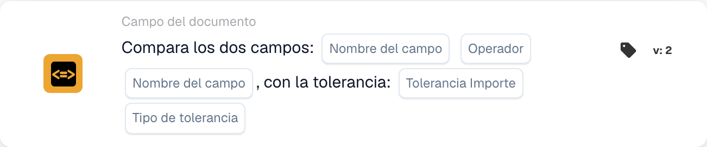

# Comparar dos campos con tolerancia

<figure><figcaption>
Campos de la tarjeta en la versión mostrada. Los campos aún no están configurados.
</figcaption></figure>

## **Propósito:**

Esta tarjeta de flujo de trabajo está diseñada para automatizar acciones comparando los valores de dos campos de documento especificados, con la capacidad añadida de aplicar un valor de tolerancia. Esta función permite al sistema considerar un margen de error (tolerancia) al comparar valores de campo, lo que posibilita una toma de decisiones más flexible dentro de los flujos de trabajo.

## **Componentes de la tarjeta:**

1. **Nombre de campo (1)**
   * **Descripción:** Especifica el primer campo de documento que se comparará.
   * **Detalle:** Debe coincidir con el identificador exacto del primer campo dentro del documento.
2. **Operador**
   * **Descripción:** Define el tipo de comparación que se realizará entre los dos campos.
   * **Opciones:**
     * **Igual a (=):** Comprueba si los valores de los dos campos son iguales.
     * **No iguales (≠):** Garantiza que los valores de los dos campos sean distintos.
     * **Mayor que (>):** Confirma que el valor del primer campo es mayor que el del segundo campo.
     * **Mayor o igual (≥):** Valida que el valor del primer campo sea igual o mayor que el del segundo campo.
     * **Menor que (<):** Comprueba si el valor del primer campo es menor que el del segundo campo.
     * **Menos o Igual (≤):** Garantiza que el valor del primer campo sea menor o igual que el del segundo campo.
3. **Nombre de campo (2)**
   * **Descripción:** Especifica el segundo campo de documento que se comparará con el primero.
   * **Detalle:** Debe coincidir con el identificador exacto del segundo campo dentro del documento.
4. **Cantidad de tolerancia**
   * **Descripción:** Define el margen de error aceptable para la comparación.
   * **Detalle:** El importe de tolerancia es un valor numérico que indica la diferencia máxima admisible entre los dos valores de campo para que la comparación se considere verdadera.
5. **Tipo de tolerancia**
   * **Descripción:** Especifica la unidad de medida del importe de tolerancia.
   * **Opciones:**
     * **Valor:** La tolerancia es un valor absoluto, lo que significa que los dos campos pueden diferir en el importe de tolerancia especificado.
     * **Percent:** La tolerancia se calcula como un porcentaje del valor del segundo campo, permitiendo un margen de error relativo.

## **Funcionalidad:**

* **Evaluación de la condición:** El sistema evalúa si los valores de los dos campos especificados cumplen la condición de comparación, teniendo en cuenta la tolerancia definida. Si la diferencia absoluta o relativa entre los dos campos está dentro de la tolerancia, la condición se considera verdadera.
* **Ejecución de la acción:**
  * **Condición verdadera:**\
    Si los valores de los dos campos, tras considerar la tolerancia, cumplen la condición de comparación, el sistema dispara las acciones asociadas. Estas acciones podrían incluir avanzar el flujo de trabajo, actualizar registros, disparar alertas o habilitar ciertas operaciones.
  * **Condición falsa:**\
    Si los valores de los dos campos, tras considerar la tolerancia, no cumplen la condición especificada, pueden ejecutarse acciones alternativas o ninguna acción, según la configuración del flujo de trabajo.

## **Configuración:**

* Los usuarios configuran la tarjeta seleccionando los dos campos que se compararán de una lista de campos disponibles en el sistema. El operador se selecciona de una lista desplegable de opciones de comparación disponibles. Los usuarios introducen el importe de tolerancia y eligen el tipo de tolerancia (valor o porcentaje).

## **Conclusión:**

La tarjeta de flujo de trabajo "Compare Two Fields with Tolerance" es una herramienta potente para comparar campos de documento teniendo en cuenta las desviaciones admisibles en los datos. Al aplicar tolerancia a las comparaciones de campos, esta tarjeta añade flexibilidad al flujo de trabajo, permitiéndole manejar las variaciones de los datos del mundo real. Mejora la toma de decisiones, facilita la validación de datos y mejora la automatización general del flujo de trabajo.

<!-- workflow-card-practical-example-20261021 -->

## Ejemplo práctico

**Cuándo usar:** Acepte una pequeña diferencia entre una cantidad extraída y una cantidad calculada por separado.

**Configuración:** Seleccione los campos numéricos `net_total` y `calculated_total`, comparación de igualdad y una tolerancia absoluta de `5`. Utilice los valores `103` y `100`.

**Resultado esperado y contraejemplo:** La diferencia es `3`, por lo que está dentro de la tolerancia. Con `110` y `100`, la diferencia es `10` y la condición de igualdad con tolerancia falla.

Esta es una configuración ilustrativa y un resultado esperado. Utilice campos, usuarios y grupos configurados en su organización de prueba; no es una afirmación de que este ejemplo haya sido ejecutado.
