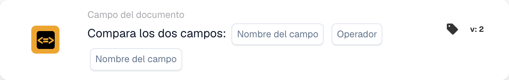

# Comparar dos campos

<figure><figcaption>
Campos de la tarjeta en la versión mostrada. Los campos aún no están configurados.
</figcaption></figure>

## **Propósito:**

Esta tarjeta de flujo de trabajo está diseñada para automatizar acciones comparando los valores de dos campos de documento especificados. Posibilita una toma de decisiones dinámica basada en los datos de los campos y garantiza que los flujos de trabajo se ejecuten en función de las comparaciones entre diferentes valores del documento.

## **Componentes de la tarjeta:**

1. **Nombre de campo (1)**
   * **Descripción:** Especifica el primer campo de documento que se comparará.
   * **Detalle:** Debe coincidir con el identificador exacto del primer campo dentro del documento.
2. **Operador**
   * **Descripción:** Define el tipo de comparación que se realizará entre los dos campos.
   * **Opciones:**
     * **Igual a (=):** Comprueba si los valores de los dos campos son iguales.
     * **No iguales (≠):** Garantiza que los valores de los dos campos sean distintos.
     * **Mayor que (>):** Confirma que el valor del primer campo es mayor que el del segundo campo.
     * **Mayor o igual (≥):** Valida que el valor del primer campo sea igual o mayor que el del segundo campo.
     * **Menor que (<):** Comprueba si el valor del primer campo es menor que el del segundo campo.
     * **Menos o Igual (≤):** Garantiza que el valor del primer campo sea menor o igual que el del segundo campo.
3. **Nombre de campo (2)**
   * **Descripción:** Especifica el segundo campo de documento que se comparará con el primero.
   * **Detalle:** Debe coincidir con el identificador exacto del segundo campo dentro del documento.

## **Funcionalidad:**

**Evaluación de la condición:** El sistema evalúa si los valores de los dos campos especificados cumplen la condición de comparación definida por el operador.

**Ejecución de la acción:**

* **Condición verdadera:**\
  Si los valores de los dos campos cumplen la condición de comparación, el sistema dispara las acciones asociadas. Estas acciones podrían incluir actualizar registros o disparar alertas.
* **Condición falsa:**\
  Si los valores de los dos campos no cumplen la condición especificada, pueden ejecutarse acciones alternativas o ninguna acción, según la configuración de los flujos de trabajo.

## **Configuración:**

* Los usuarios configuran la tarjeta seleccionando los dos campos que se compararán de una lista de campos disponibles en el sistema. El operador se selecciona de una lista desplegable de opciones de comparación disponibles.

## **Conclusión:**

La tarjeta de flujo de trabajo "Compare Two Fields" es una herramienta esencial para comparar datos entre campos dentro de los documentos. Al automatizar acciones según las comparaciones de campos, esta tarjeta ayuda a optimizar la toma de decisiones, facilita la validación de datos y mejora la automatización del flujo de trabajo.
