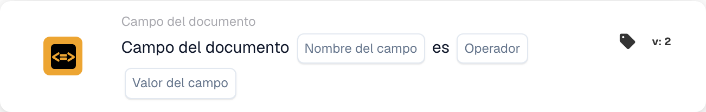

# Estado del campo de documento

<figure><figcaption>
Campos de la tarjeta en la versión mostrada. Los campos aún no están configurados.
</figcaption></figure>

## **Propósito:**

Esta tarjeta de flujo de trabajo está diseñada para automatizar acciones comparando el valor de un campo de documento especificado con un valor o condición de referencia. Garantiza una toma de decisiones dinámica y precisa en los flujos de trabajo basada en la validación de los datos del documento.

## **Componentes de la tarjeta:**

1. **Nombre de campo**
   * **Descripción:** Especifica el nombre del campo del documento que se evaluará.
   * **Detalle:** Debe coincidir con el identificador exacto del campo dentro del documento.
2. **Operadores**
   * **Descripción:** Define el tipo de comparación que se realizará entre el valor del campo y el valor de referencia.
   * **Opciones:**
     * **Igual a (=):** Comprueba si el valor del campo coincide con el valor de referencia.
     * **No iguales (≠):** Garantiza que el valor del campo difiera del valor de referencia.
     * **Mayor que (>):** Confirma que el valor del campo es mayor que el valor de referencia.
     * **Mayor o igual (≥):** Valida que el valor del campo sea igual o mayor que el valor de referencia.
     * **Menor que (<):** Comprueba si el valor del campo es menor que el valor de referencia.
     * **Menos o Igual (≤):** Garantiza que el valor del campo sea menor o igual que el valor de referencia.

## **Funcionalidad:**

* **Evaluación de la condición:** El sistema comprueba si el valor del campo del documento, en relación con su columna asociada, cumple la condición de comparación especificada por el operador y el valor de referencia.
* **Ejecución de la acción:**
  * **Condición verdadera:**\
    Si el valor del campo del documento cumple la condición especificada (p. ej., es igual al valor de referencia), el sistema dispara las acciones asociadas. Estas podrían incluir actualizar registros, avanzar el flujo de trabajo o generar notificaciones.
  * **Condición falsa:**\
    Si el valor del campo del documento no cumple la condición especificada, se ejecutan acciones alternativas o ninguna acción, según la configuración del flujo de trabajo.

## **Configuración:**

* El usuario selecciona el nombre del campo del documento pertinente y elige el operador del menú desplegable. A continuación, el usuario especifica el valor del campo de referencia para completar la configuración.

## **Conclusión:**

La tarjeta de flujo de trabajo "DocField Comparison Validation" es una herramienta robusta para el procesamiento dinámico de documentos. Al automatizar acciones según las comparaciones de campos, esta tarjeta agiliza los flujos de trabajo, mejora la precisión y facilita la toma de decisiones basada en datos.
