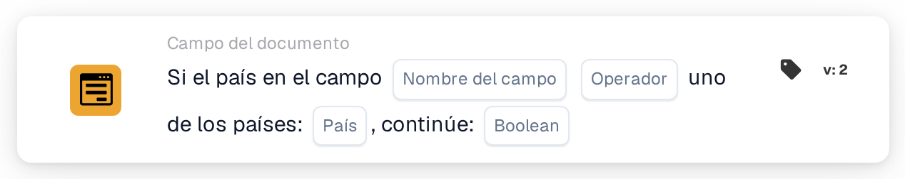

# Si el país en el campo es uno de

<figure><figcaption>
Versión 2
</figcaption></figure>

Utilice esta condición cuando un paso de procesamiento adicional deba aplicarse a documentos de determinados países, por ejemplo Alemania y Francia. La tarjeta compara el país leído de un campo del documento con una lista de países configurada.

**Ubicación:** Flujo estándar → condiciones adicionales (AND) → Campo del documento. Configure la acción posterior por separado en THEN.

## Configuración — versión 2

| Ajuste | Valor |
| --- | --- |
| Campo | Un campo de texto existente que contenga el nombre del país |
| Operador | `is` |
| Países | `Germany, France` |
| Valor de continuación | `true` |

<!-- workflow-card-practical-example-20261021 -->

## Ejemplo práctico

| Valor del país en el campo | Condición esperada |
| --- | --- |
| `Germany` | Se cumple |
| `France` | Se cumple |
| `United States` | No se cumple |

Los nombres de países mostrados como código son valores de entrada fijos para este ejemplo.

## Límites y comprobaciones

`false` no invierte la comparación. Con ese ajuste, ni siquiera un país coincidente produce una condición positiva. Para comprobar la condición contraria, seleccione `isnot` con `true`.

Gestione por separado los campos ausentes y los valores de país vacíos; pueden devolver un resultado de datos faltantes en lugar de una falta de coincidencia normal.

La revisión del código fuente de la versión de desarrollo del 22 de octubre de 2026 muestra un error de conversión para entradas ISO como `DE` y `DEU`. Por eso, estos ejemplos utilizan nombres de países completos. Compruebe por separado el tratamiento de códigos ISO en su versión instalada.
