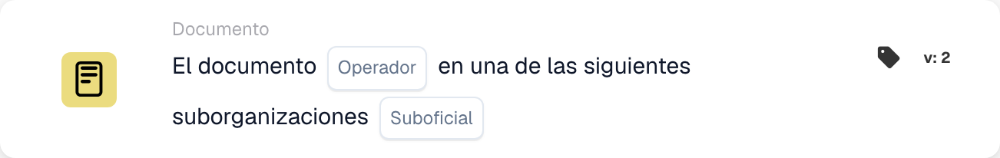

# Documento

Las tarjetas de esta categoría en el selector **Agregar tarjeta** del Workflow Builder:

<figure><figcaption>
Tarjetas disponibles en la categoría seleccionada. Configure los campos antes de utilizarlas. Algunas etiquetas de esta versión de la tarjeta todavía tienen una traducción incompleta o incorrecta en la interfaz. Las explicaciones de esta página utilizan los términos correctos.
</figcaption></figure>

<!-- workflow-card-example-condition_sub_org_is_isnot_in_list-20261021 -->

### Documento en una de varias suborganizaciones.

<figure><figcaption>
Campos de la tarjeta en la versión mostrada. Los campos aún no están configurados. Algunas etiquetas de esta versión de la tarjeta todavía tienen una traducción incompleta o incorrecta en la interfaz. Las explicaciones de esta página utilizan los términos correctos.
</figcaption></figure>

`CONDITION_SUB_ORG_IS_ISNOT_IN_LIST` · versión 2

Seleccione es una de las suborganizaciones configuradas `Demo North` y `Demo South`. Pasa un documento perteneciente a cualquiera de las unidades seleccionadas; `Demo Default` falla. Esto verifica la suborganización del documento; no lo cambia.
