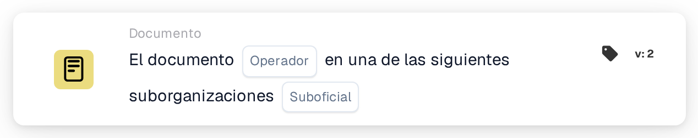

# Operador de documentos para suborganizaciones uno de

<figure><figcaption>
Versión 2
</figcaption></figure>

## Propósito:

Esta tarjeta de flujo de trabajo comprueba si un documento pertenece a una de varias suborganizaciones. En lugar de comparar el documento con una sola suborganización, lo compara con una lista, de modo que una sola tarjeta cubre un grupo de suborganizaciones que deben tratarse igual. Según el resultado, el flujo de trabajo continúa con la condición verdadera o la falsa.

Para comparar con una sola suborganización, se puede utilizar la tarjeta **Document Operator for Sub-Organizations**.

## Componentes de la tarjeta:

1. **Operator**
   * **Descripción:** Define si el documento debería pertenecer a una de las suborganizaciones indicadas o a ninguna de ellas.
   * **Opciones:**
     * **Is:** La condición es verdadera si la suborganización del documento es una de las suborganizaciones indicadas.
     * **Is Not:** La condición es verdadera si la suborganización del documento no está en la lista.
2. **Sub-org**
   * **Descripción:** La lista de suborganizaciones con las que se compara el documento.
   * **Detalle:** Se pueden seleccionar una o varias suborganizaciones de la organización. Se compara la suborganización a la que está asignado el documento.

## Funcionalidad:

* **Evaluación de la condición:** El sistema lee la suborganización del documento y comprueba si es una de las suborganizaciones seleccionadas en la tarjeta.
* **Ejecución de la acción:**
  * **Condición verdadera:**\
    Con **Is**, la suborganización del documento está en la lista; con **Is Not**, no lo está. El flujo de trabajo continúa con la condición verdadera, por ejemplo para enviar el documento al equipo responsable de estas suborganizaciones o aplicar reglas que solo se aplican a ellas.
  * **Condición falsa:**\
    Si no se cumple la condición, el flujo de trabajo continúa con la condición falsa, por ejemplo para aplicar reglas generales o enviar el documento a otro lugar.
* **Datos que faltan:** Si el documento no está asignado a ninguna suborganización, o no hay ninguna suborganización seleccionada en la tarjeta, la tarjeta no evalúa la condición. Registra los datos que faltan en el registro del flujo de trabajo en lugar de continuar con la condición falsa.

## Configuración:

* La tarjeta se puede añadir desde la categoría **Documento**. A continuación se pueden elegir el operador (**Is** o **Is Not**) y, en el campo **Sub-org**, las suborganizaciones con las que se compara. Por último se define la condición de continuación (verdadera o falsa), que determina el siguiente paso del flujo de trabajo.

## Conclusión:

La tarjeta de flujo de trabajo «Document Operator for Sub-Organizations one of» permite que una sola condición cubra varias suborganizaciones a la vez. Así los flujos de trabajo siguen siendo cortos cuando varias suborganizaciones comparten las mismas reglas de procesamiento, y los documentos se tratan en el contexto organizativo correcto.
