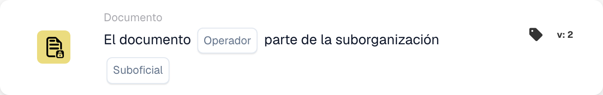

# Operador de documentos para suborganizaciones

<figure><figcaption>
Campos de la tarjeta en la versión mostrada. Los campos aún no están configurados. Algunas etiquetas de esta versión de la tarjeta todavía tienen una traducción incompleta o incorrecta en la interfaz. Las explicaciones de esta página utilizan los términos correctos.
</figcaption></figure>

## Propósito:

Esta tarjeta de flujo de trabajo evalúa si un documento forma parte de una suborganización específica. Según esta evaluación, el flujo de trabajo puede continuar o disparar diferentes acciones según si el documento está asociado o no a la suborganización especificada.

## Componentes de la tarjeta:

1. **Operador**
   * **Descripción:** Define si el documento debe formar parte de la suborganización especificada o no.
   * **Opciones:**
     * **Is:** El documento debe formar parte de la suborganización especificada para que la condición sea verdadera.
     * **No es:** El documento no debe formar parte de la suborganización especificada para que la condición sea verdadera.
2. **Suborganización**
   * **Descripción:** Especifica la suborganización con la que se debe comparar el documento.
   * **Detalle:** Debe coincidir con el identificador de la suborganización. La comparación comprueba si el documento pertenece a la suborganización especificada.

## Funcionalidad:

* **Evaluación de la condición:** El sistema evalúa si el documento forma parte de la suborganización especificada. Esta evaluación comprueba la suborganización del documento frente a la proporcionada por el usuario.
* **Ejecución de la acción:**
  * **Condición verdadera:**\
    Si el documento forma parte de la suborganización especificada, el flujo de trabajo continúa con la condición verdadera. Esto podría disparar acciones adicionales, como enrutar el documento a un departamento específico, aplicar reglas específicas de la suborganización o habilitar funciones adaptadas a esa suborganización.
  * **Condición falsa:**\
    Si el documento no forma parte de la suborganización especificada, el flujo de trabajo continúa con la condición falsa. Esto permite ejecutar acciones alternativas, como enviar notificaciones, detener el flujo de trabajo o aplicar reglas generales fuera del ámbito de la suborganización.

## Configuración:

* Los usuarios configuran la tarjeta seleccionando el campo del documento que contiene el documento y especificando la suborganización con la que comparar. A continuación, se elige el operador de una lista desplegable para definir si el documento debe formar parte o no de la suborganización especificada. Por último, los usuarios establecen la condición de continuación (verdadera o falsa), que determina el siguiente paso del flujo de trabajo.

## Conclusión:

La tarjeta de flujo de trabajo "Document in Sub-organization" es una herramienta útil para automatizar acciones según si un documento pertenece a una suborganización particular. Al garantizar que los documentos se procesen según las reglas específicas de la suborganización, esta tarjeta mejora la eficiencia del flujo de trabajo y garantiza que las acciones se ejecuten dentro del contexto organizativo correcto.

<!-- workflow-card-practical-example-20261021 -->

## Ejemplo práctico

**Cuándo utilizar:** Enrutar documentos que pertenecen a una unidad de negocio.

**Configuración:** Seleccione la suborganización `Demo North` y el operador igual.

**Resultado esperado y contraejemplo:** Se aprueba un documento en `Demo North`. Un documento en `Demo South` falla.

Esta es una configuración ilustrativa y un resultado esperado. Utilice campos, usuarios y grupos configurados en su organización de prueba; no es una afirmación de que este ejemplo haya sido ejecutado.
