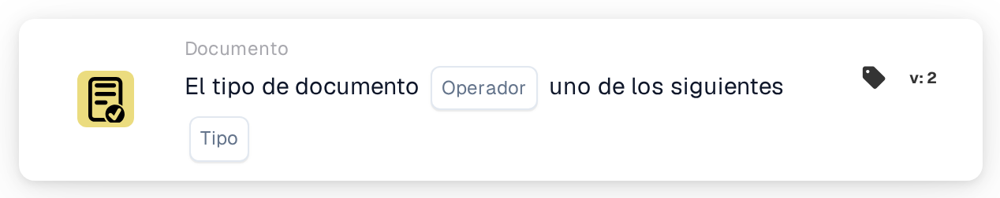

# Tipo de documento Operación uno de

<figure><figcaption>
Versión 2
</figcaption></figure>

## **Propósito:**

Esta tarjeta está diseñada para gestionar acciones sobre los documentos en función de su tipo, empleando lógica condicional simple (is/is not) para disparar o impedir flujos de trabajo específicos. Esto permite un control preciso sobre cómo se procesan los diferentes tipos de documentos dentro del sistema ERP.

## **Componentes de la tarjeta:**

1. **Operador**
   * **Descripción**: Determina la lógica condicional que se aplica a los tipos de documento.
   * **Opciones**:
     * **is**: La operación se disparará si el tipo del documento coincide con uno de los tipos especificados en la lista.
     * **no es**: La operación se disparará si el tipo del documento no coincide con ninguno de los tipos enumerados.
2. **Lista de tipos de documentos**
   * **Descripción**: Especifica una lista de tipos de documento a los que se aplicará la condición.
   * **Detalle**: Incluye una variedad de tipos de documento como "Invoice", "Purchase Order", etc., en función de los cuales se evaluará la condición (is/is not).

## Funcionalidad:

* **Evaluación de la condición:** El sistema comprueba si el tipo de documento cumple la condición del operador (is o is not) frente a la lista de tipos de documento especificada.
* **Ejecución de la acción:**
  * **Condición verdadera:**\
    Si el tipo de documento cumple la condición especificada (está o no está en la lista), el flujo de trabajo continúa. Esto podría disparar procesos como aprobaciones de documentos, validaciones específicas o acciones de enrutamiento.
  * **Condición falsa:**\
    Si el tipo de documento no cumple la condición, se ejecutan acciones alternativas, como rechazar el documento o detener el flujo de trabajo.

## Configuración:

* Los usuarios configuran la tarjeta seleccionando el campo del tipo de documento y definiendo el operador (is o is not). A continuación, especifican la lista de tipos de documento con la que comparar. La configuración es sencilla e implica menús desplegables para la selección del campo y el operador y un campo para introducir la lista de tipos de documento.

## Conclusión:

La tarjeta de flujo de trabajo "Document Type Condition" desempeña un papel crucial en la gestión de operaciones basadas en documentos con precisión y flexibilidad. Al usar lógica condicional simple, ayuda a garantizar que los documentos se procesen de forma adecuada, mejorando la eficiencia y el cumplimiento. Documentar claramente esta tarjeta ayudará a los usuarios a comprender cómo implementarla y utilizarla de forma eficaz, convirtiéndola en una parte valiosa de la documentación de su sistema ERP.

<!-- workflow-card-practical-example-20261021 -->

## Ejemplo práctico

**Cuándo utilizar:** Utilice la misma validación para varios tipos de documentos.

**Configuración:** Seleccione el operador es uno de y los tipos `Invoice` y `Credit Note`.

**Resultado esperado y contraejemplo:** Un `Invoice` pasa; un `Order` no lo hace.

Esta es una configuración ilustrativa y un resultado esperado. Utilice campos, usuarios y grupos configurados en su organización de prueba; no es una afirmación de que este ejemplo haya sido ejecutado.
