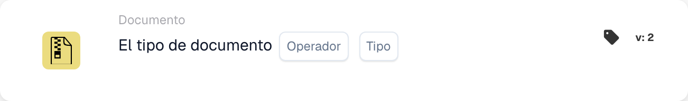

# Tipo de documento

<figure><figcaption>
Campos de la tarjeta en la versión mostrada. Los campos aún no están configurados.
</figcaption></figure>

## Propósito:

Esta tarjeta de flujo de trabajo está diseñada para evaluar si un documento coincide con un tipo específico. Al comprobar si el documento corresponde al tipo dado, los flujos de trabajo pueden continuar o tomar acciones alternativas según esta condición. Esto ayuda a automatizar procesos en los que el tipo de documento determina los siguientes pasos del flujo de trabajo.

## Componentes de la tarjeta:

1. **Operador**
   * **Descripción**: Define si el documento debe ser del tipo especificado o no.
   * **Opciones**:
     * **Is**: El documento debe coincidir con el tipo especificado para que la condición sea verdadera.
     * **no es**: El documento no debe coincidir con el tipo especificado para que la condición sea verdadera.
2. **Tipo**
   * **Descripción**: Especifica el tipo de documento con el que comparar.
   * **Detalle**: Incluye una variedad de tipos de documento como "Invoice", "Purchase Order", etc., en función de los cuales se evaluará la condición (is/is not).

## Funcionalidad:

* **Evaluación de la condición**: El sistema evalúa si el tipo de documento del campo especificado cumple la condición definida por el operador. Compara el valor del campo con el tipo de documento proporcionado.
* **Ejecución de la acción**:
  * **Condición verdadera**: Si el tipo de documento coincide con el tipo especificado (o no, según el operador), el flujo de trabajo continúa con la condición verdadera. Esto puede disparar acciones como el procesamiento adicional del documento, enviarlo para su aprobación o aplicar reglas específicas según el tipo de documento.
  * **Condición falsa**: Si el tipo de documento no coincide con el tipo especificado, el flujo de trabajo continúa con la condición falsa. Esto puede disparar acciones alternativas, como enrutar el documento a un proceso diferente o detener acciones adicionales.

## Configuración:

* Los usuarios configuran la tarjeta seleccionando el campo del documento que contiene el tipo de documento de una lista de campos disponibles. A continuación, se selecciona el operador para definir si el documento debe ser del tipo especificado o no. Por último, los usuarios establecen la condición de continuación (verdadera o falsa), que determina la siguiente acción según el tipo de documento.

## Conclusión:

La tarjeta de flujo de trabajo "Document Type Comparison" es esencial para garantizar que los flujos de trabajo continúen según el tipo de documento que se está procesando. Al comparar el tipo de documento, ayuda a las organizaciones a automatizar las tareas de enrutamiento y procesamiento de documentos, garantizando que los documentos se manejen de forma adecuada según su tipo.

<!-- workflow-card-practical-example-20261021 -->

## Ejemplo práctico

**Cuándo usarlo:** Ejecute una verificación específica de la factura.

**Configuración:** Seleccione el tipo de documento `Invoice` y el operador igual.

**Resultado esperado y contraejemplo:** Se aprueba una factura. Una nota de crédito no pasa esta condición.

Esta es una configuración ilustrativa y un resultado esperado. Utilice campos, usuarios y grupos configurados en su organización de prueba; no es una afirmación de que este ejemplo haya sido ejecutado.
