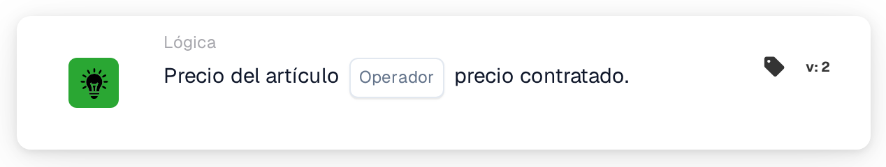
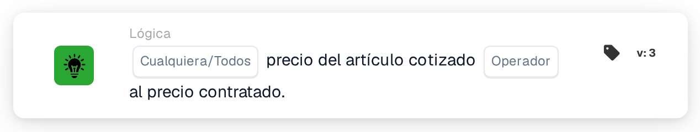

# Precio del artículo cotizado

<figure><figcaption>
Versión 2
</figcaption></figure>

<figure><figcaption>
Versión 3
</figcaption></figure>

## **Propósito:**

Esta tarjeta DocBits compara el precio cotizado de un artículo con su precio contratado, lo que permite que los flujos de trabajo activen acciones en función de si los dos valores coinciden o difieren. Ayuda a garantizar la coherencia de los precios y el cumplimiento de los términos del contrato.

## **Funcionalidad:**

* **Comparación de precios:** Esta tarjeta evalúa si el precio del artículo cotizado cumple con la condición especificada en relación con el precio contratado.
* **Operadores:** Se pueden aplicar las siguientes condiciones:
  * **Equal (=):** Comprueba si el precio cotizado coincide con el precio contratado.
  * **No es igual a (≠):** Asegura que el precio cotizado sea diferente al precio contratado.

## **Uso:**

Esta tarjeta es particularmente útil en flujos de trabajo de adquisiciones, ventas o gestión de contratos, donde es crucial validar que los precios cotizados se alinean con los términos del contrato acordados antes de proceder con las aprobaciones o el procesamiento de pedidos.

## **Escenario de ejemplo:**

* Un usuario configura la tarjeta para comprobar si el **precio cotizado es igual a (=)** el **precio contratado**. Si los precios coinciden, el flujo de trabajo procede a la aprobación; de lo contrario, activa una notificación de revisión manual para resolver la discrepancia.

Al utilizar la tarjeta "Precio del artículo cotizado versus precio contratado", las organizaciones pueden hacer cumplir las políticas de precios, mantener el cumplimiento del contrato y reducir los errores en las transacciones financieras.

## Versión 3: cualquiera o todos

La versión 3 agrega `match_any` y `match_all`. Cualquiera requiere al menos una línea comparable exitosa; Todo requiere que cada línea comparada satisfaga al operador seleccionado. La versión 2 conserva Todo. Una selección no configurada en v3 tiene como valor predeterminado Todos y se registra. A ninguna línea comparable le faltan datos, no hay una coincidencia exitosa. Consulte [Tarjetas de comparación de citas](../../cards-overview/quote-comparison-guide.md) para obtener resultados mixtos, líneas omitidas y pruebas.
