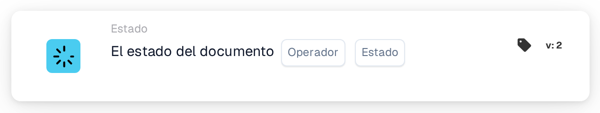

# Condición de estado de documento único

<figure><figcaption>
Versión 2
</figcaption></figure>

**Propósito**

Esta tarjeta de flujo de trabajo está adaptada para gestionar operaciones sobre los documentos según un único estado de documento especificado. Al simplificar la condición a un solo estado, la tarjeta se centra en disparadores de flujo de trabajo muy específicos, lo que la hace ideal para actividades de procesamiento de documentos dirigidas dentro de un sistema ERP.

**Componentes de la tarjeta**

1. **Operador**
   * **Descripción**: Especifica el método para evaluar el estado del documento frente a la condición seleccionada.
   * **Opciones**:
     * **is**: Dispara la operación si el estado actual del documento coincide con el estado seleccionado.
     * **no es**: Dispara la operación si el estado actual del documento no coincide con el estado seleccionado.
2. **Estado**
   * **Descripción**: Permite seleccionar un único estado de documento para establecer la condición.
   * **Ejemplos de estados**: "Error", "Error de exportación", "Listo en validación", "Listo en revisión", "Pendiente de aprobación", "Pendiente de segunda aprobación".
   * **Detalle**: Los usuarios eligen un estado de un desplegable o de un conjunto de botones de opción. Este estado sirve entonces como criterio para la operación de la tarjeta.

**Funcionalidad**

* **Identificación del estado del documento**: Identifica el estado actual de un documento a medida que se procesa a través del sistema ERP.
* **Evaluación de la condición**:
  * Según el operador seleccionado (`is` o `is not`), la tarjeta comprueba si el estado actual del documento se ajusta al criterio de estado elegido.
* **Ejecución de la acción**:
  * **Condición verdadera**: Si el estado coincide (o no coincide, según el operador), se inicia la acción correspondiente. Esto podría ser el enrutamiento para un procesamiento adicional, la generación de notificaciones u otros flujos de trabajo predefinidos.
  * **Condición falsa**: Si la condición no se cumple, no se realiza ninguna acción o se dispara una ruta alternativa.
* **Integración con otros flujos de trabajo**: Aunque está diseñada para la evaluación de un solo estado, esta tarjeta se puede integrar de forma eficaz en secuencias de flujo de trabajo más amplias para garantizar un manejo preciso de los documentos.

**Interacciones del usuario**

* **Configuración**: Los usuarios configuran la tarjeta seleccionando un operador y eligiendo después un estado de las opciones disponibles. Este proceso de selección es sencillo y está diseñado para evitar confusiones.
* **Supervisión e informes**: Posibilita la supervisión mediante informes o paneles generados por el sistema que hacen seguimiento del procesamiento de los documentos según su estado, ayudando a controlar la eficacia de los flujos de trabajo implementados.
* **Gestión de errores y notificaciones**: Se puede configurar para alertar a los usuarios de cualquier anomalía de procesamiento o para señalar los documentos que no cumplen las condiciones establecidas, garantizando una atención y resolución rápidas.

#### Conclusión

La tarjeta de flujo de trabajo "Single Document Status Condition" simplifica la gestión de documentos centrándose en condiciones de estado individuales. Esta especificación ayuda en los casos en los que es necesario un control preciso de los flujos de documentos, especialmente en entornos con criterios de procesamiento estrictos. Documentar claramente esta versión de la tarjeta garantizará que los usuarios comprendan plenamente su aplicación y puedan integrarla de forma eficaz en sus operaciones diarias, mejorando tanto el cumplimiento como la eficiencia en el procesamiento de documentos.

<!-- workflow-card-complete-example-20261021 condition_doc_status_is_isnot -->

### Ejemplo de estado único

**Configuración:** Elija operador `is` y estado `Pending Approval`. Agregue una siguiente acción de revisión apropiada para ese estado.

**Resultado esperado y contraejemplo:** La condición es verdadera para un documento actualmente `Pending Approval`; es falso para un documento con estado `Ready in Validation`. Utilice el estado seleccionado real de su lanzamiento. Cambiar un estado no exporta el documento.

Esta es una configuración de prueba ilustrativa y el resultado esperado; no fue ejecutado. Utilice datos y destinatarios configurados en su organización de prueba.
