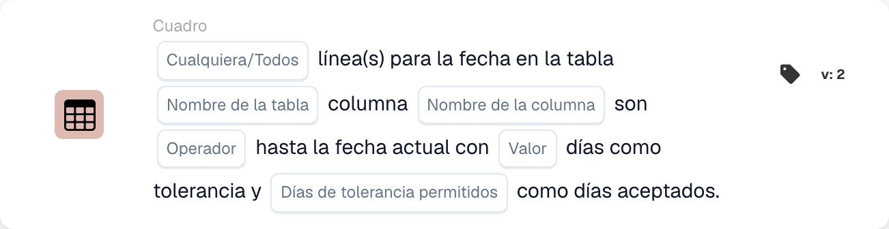

# tabla

Las tarjetas de esta categoría en el selector **Agregar tarjeta** del Workflow Builder:

<figure><figcaption>
Tarjetas disponibles en la categoría seleccionada. Configure los campos antes de utilizarlas. Algunas etiquetas de esta versión de la tarjeta todavía tienen una traducción incompleta o incorrecta en la interfaz. Las explicaciones de esta página utilizan los términos correctos.
</figcaption></figure>

<!-- workflow-card-example-condition_table_column_exists-20261021 -->

### La tabla de documentos contiene una columna.

<figure><figcaption>
Campos de la tarjeta en la versión mostrada. Los campos aún no están configurados.
</figcaption></figure>

`CONDITION_TABLE_COLUMN_EXISTS` · versión 2

Seleccione la tabla `lines`, la columna `article_number` y el operador existe. Pasa una tabla poblada que contiene esa columna; la misma tabla sin la columna falla en la comparación de existencia. Una tabla ausente o vacía puede producir un resultado de datos faltantes y no es prueba de una comparación negativa exitosa.

<!-- workflow-card-example-condition_compare_table_date_to_current_date-20261021 -->

### Fechas en una tabla con respecto a la fecha de referencia.

<figure><figcaption>
Campos de la tarjeta en la versión mostrada. Los campos aún no están configurados.
</figcaption></figure>

`CONDITION_COMPARE_TABLE_DATE_TO_CURRENT_DATE` · versión 2

Para la fecha de referencia `2026-10-21`, compare la tabla `lines`, la columna `delivery_date`, la tolerancia posterior a, Todo y el día cero. Las filas fechadas `2026-10-22` y `2026-10-23` satisfacen la comparación. Una fila con fecha `2026-10-20` hace que Todo falle. Pruebe las fechas faltantes y no válidas por separado.
