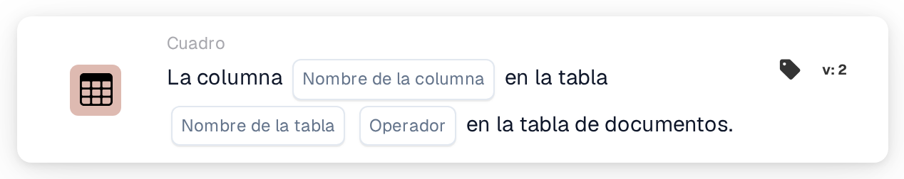

# La columna existe en la tabla

<figure><figcaption>
Versión 2
</figcaption></figure>

## Propósito:

Esta tarjeta de flujo de trabajo comprueba si una tabla del documento contiene una columna concreta. Puede utilizarse para ejecutar tarjetas posteriores solo en documentos cuya tabla contiene los datos necesarios, por ejemplo una columna de fecha de entrega o de número de artículo, o para dirigir a otro lugar los documentos con una estructura de tabla diferente. Según el resultado, el flujo de trabajo continúa con la condición verdadera o con la falsa.

## Componentes de la tarjeta:

1. **Nombre de la columna**
   * **Descripción:** El nombre de la columna que busca la tarjeta.
   * **Detalle:** El nombre de la columna se compara sin distinguir entre mayúsculas y minúsculas.
2. **Nombre de la tabla**
   * **Descripción:** El nombre de la tabla del documento que se comprueba.
   * **Detalle:** El nombre de la tabla se compara sin distinguir entre mayúsculas y minúsculas.
3. **Operador**
   * **Descripción:** Define si la columna debería estar presente en la tabla o no.
   * **Opciones:**
     * **Es:** La condición es verdadera si la tabla contiene la columna.
     * **No Es:** La condición es verdadera si la tabla no contiene la columna.

## Funcionalidad:

* **Evaluación de la condición:** La tarjeta busca la tabla del documento con el nombre indicado y comprueba si la primera fila de esa tabla tiene una columna con el nombre indicado. La columna encontrada, o las columnas que había en su lugar, se anotan en el registro del flujo de trabajo.
* **Ejecución de la acción:**
  * **Condición verdadera:**\
    Con **Es**, la columna está en la tabla. Con **No Es**, no lo está. El flujo de trabajo continúa con la condición verdadera, por ejemplo para ejecutar una comparación sobre esta columna.
  * **Condición falsa:**\
    Si no se cumple la condición, el flujo de trabajo continúa con la condición falsa.
* **Datos que faltan:** La tarjeta no evalúa la condición y registra los datos que faltan en el registro del flujo de trabajo si no se ha definido ningún nombre de columna o de tabla en la tarjeta, si el documento no tiene ninguna tabla con el nombre indicado, o si esa tabla no tiene filas o su primera fila no tiene columnas.
* **Errores:** Si no se ha definido ningún operador o se ha definido un operador distinto de **Es** o **No Es**, la tarjeta registra un error de configuración.

## Configuración:

* La tarjeta se puede añadir desde la categoría **Cuadro**. A continuación se pueden definir el nombre de la columna, el nombre de la tabla y el operador (**Es** o **No Es**). Por último se define la condición de continuación (verdadera o falsa), que determina el siguiente paso del flujo de trabajo.

## Conclusión:

La tarjeta de flujo de trabajo «Column Exists in Table» comprueba la estructura de una tabla del documento antes de utilizar sus datos. Colocada antes de otras tarjetas de tabla, ayuda a garantizar que esas tarjetas solo se ejecuten en documentos que contienen la columna esperada.
