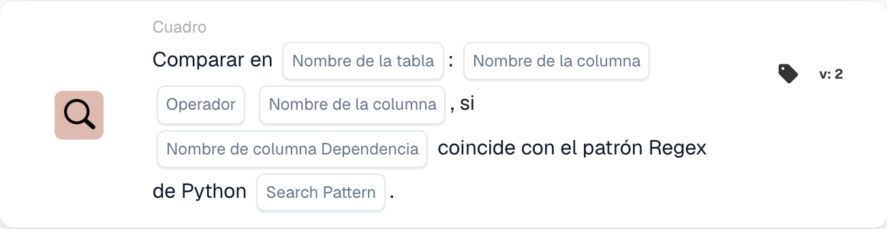

# Comparar en

<figure><figcaption>
Campos de la tarjeta en la versión mostrada. Los campos aún no están configurados. Algunas etiquetas de esta versión de la tarjeta todavía tienen una traducción incompleta o incorrecta en la interfaz. Las explicaciones de esta página utilizan los términos correctos.
</figcaption></figure>

## **Propósito:**

Esta tarjeta de DocBits realiza una comparación entre dos columnas de una tabla especificada, permitiendo a los usuarios establecer condiciones basadas en los valores de cada columna. Además, esta tarjeta incluye una función de dependencia, en la que la comparación solo se realizará si el valor de una tercera columna coincide con un patrón regex de Python especificado. Esta configuración es útil para comprobaciones condicionales que dependen de múltiples puntos de datos dentro de un conjunto de datos.

## **Funcionalidad:**

* **Comparación de columnas con dependencia:** Esta tarjeta compara los valores de dos columnas especificadas según una condición establecida, que solo se aplica si el valor de una tercera columna de "dependencia" coincide con un patrón regex de Python definido.
* **Operadores:** Los usuarios pueden elegir los siguientes operadores para la comparación de columnas:
  * **Igual a (=):** Comprueba si los valores de las dos columnas son exactamente iguales.
  * **No iguales (≠):** Garantiza que los valores de las dos columnas no sean iguales.
  * **Mayor que (>):** Confirma que los valores de la primera columna son mayores que los de la segunda columna.
  * **Mayor o igual (≥):** Garantiza que los valores de la primera columna sean mayores o iguales que los de la segunda columna.
  * **Menor que (<):** Comprueba si los valores de la primera columna son menores que los de la segunda columna.
  * **Menos o Igual (≤):** Garantiza que los valores de la primera columna sean menores o iguales que los de la segunda columna.
* **Dependencia regex:** Esta tarjeta incluye una función de dependencia que permite a los usuarios definir un patrón regex para una tercera columna. La condición de comparación solo se aplica si al menos un valor de la columna de dependencia coincide con el patrón regex.

## **Uso:**

Esta tarjeta es especialmente útil en escenarios en los que se requiere lógica condicional compleja, como las comprobaciones de calidad que dependen de las relaciones entre puntos de datos, con condiciones adicionales basadas en el formato de los datos o patrones específicos.

***

## **Ejemplo de escenario:**

* Un usuario configura la tarjeta para comparar las columnas "Quantity" y "Threshold" de una tabla "Stock" con la condición **Cantidad ≥ Umbral**. Esta comparación solo se realiza si la columna "Item Code" coincide con el patrón regex de formatos de código específicos, como **^A\d{3}$** (que indica un código de artículo que empieza por "A" seguido de tres dígitos).

Al usar la tarjeta "Conditional Column Comparison", las organizaciones pueden crear comparaciones avanzadas dependientes de patrones dentro de los conjuntos de datos, posibilitando un procesamiento de datos ajustado y una mayor precisión en los flujos de trabajo condicionales.
