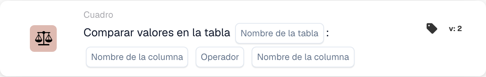

# Comparar valores en la tabla

<figure><figcaption>
Campos de la tarjeta en la versión mostrada. Los campos aún no están configurados.
</figcaption></figure>

## **Propósito:**

Esta tarjeta de DocBits realiza una comparación entre los valores de dos columnas especificadas dentro de una tabla, según una condición elegida. Es útil para escenarios que requieren validar las relaciones entre puntos de datos, como el control de calidad, las comprobaciones de coherencia de datos o la verificación de cumplimiento.

## **Funcionalidad:**

* **Comparación de columnas:** Esta tarjeta permite a los usuarios establecer condiciones para comparar valores entre dos columnas de la misma tabla.
* **Operadores:** Los siguientes operadores están disponibles para definir la comparación:
  * **Igual a (=):** Comprueba si los valores de las dos columnas son exactamente iguales.
  * **No iguales (≠):** Garantiza que los valores de las dos columnas no sean iguales.
  * **Mayor que (>):** Confirma que los valores de la primera columna son mayores que los de la segunda columna.
  * **Mayor o igual (≥):** Garantiza que los valores de la primera columna sean mayores o iguales que los de la segunda columna.
  * **Menor que (<):** Comprueba si los valores de la primera columna son menores que los de la segunda columna.
  * **Menos o Igual (≤):** Garantiza que los valores de la primera columna sean menores o iguales que los de la segunda columna.
* **Selección de tabla y columna:** Los usuarios especifican la tabla y las dos columnas que desean comparar.

## **Uso:**

Esta tarjeta es ideal para analistas de datos, equipos de control de calidad o responsables de cumplimiento que necesitan garantizar que los valores de una columna se relacionen con los valores de otra según reglas específicas, posibilitando una validación de datos avanzada.

## **Ejemplo de escenario:**

* Un usuario configura la tarjeta para comprobar si los valores de la columna "Current Stock" son **mayores o iguales que (≥)** los valores de la columna "Minimum Stock Level" de la tabla "Inventory". Si todos los valores cumplen esta condición, el flujo de trabajo continúa, confirmando que los niveles de existencias son adecuados.

Al usar la tarjeta "Column Value Comparison", las organizaciones pueden garantizar la coherencia de los datos, mantener los estándares de calidad y validar las relaciones de datos dentro de las tablas.
