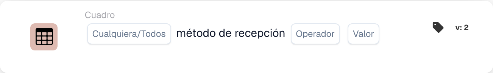

# Método de recepción del artículo

<figure><figcaption>
Campos de la tarjeta en la versión mostrada. Los campos aún no están configurados.
</figcaption></figure>

## **Propósito:**

Esta tarjeta de DocBits comprueba si los artículos de un conjunto de datos tienen un método de recepción especificado. Los usuarios pueden optar por validar **algún** artículo o **todos** los artículos del conjunto de datos según una condición seleccionada, lo que la hace adecuada para escenarios en los que los flujos de trabajo dependen de los métodos de recepción de artículos, como en la gestión de la cadena de suministro o el seguimiento de inventario.

## **Funcionalidad:**

* **Validación del método de recepción:** Esta tarjeta verifica el método de recepción de los artículos frente a una condición especificada. Los usuarios pueden elegir entre **algún** artículo o **todos** los artículos del conjunto de datos y establecer la condición como **equals** o **no es igual**.
* **Selección de artículos:** Los usuarios pueden especificar:
  * **Any Item:** La tarjeta se dispara si al menos un artículo cumple la condición de método de recepción especificada.
  * **Todos los artículos:** La tarjeta se dispara solo si todos los artículos cumplen la condición de método de recepción especificada.
* **Operadores:** Los siguientes operadores están disponibles para definir la condición:
  * **Igual a (=):** Comprueba si el método de recepción coincide con el valor especificado.
  * **No iguales (≠):** Garantiza que el método de recepción no coincida con el valor especificado.

## **Uso:**

Esta tarjeta es ideal para los responsables de almacén, los coordinadores de inventario o el personal de logística que necesitan validar los métodos de recepción de los artículos antes de permitir acciones adicionales, como el procesamiento, el almacenamiento o el envío.

## **Ejemplo de escenario:**

* Un usuario configura la tarjeta para comprobar si **todos los artículos** tienen el método de recepción **igual a "Entrega Directa"**. Si todos los artículos cumplen esta condición, el flujo de trabajo continúa, confirmando que todos los artículos están destinados a la entrega directa.

Al usar la tarjeta "Receiving Method Validation", las organizaciones pueden garantizar el cumplimiento de los protocolos de recepción, mejorar los flujos de trabajo logísticos y mantener la precisión en el manejo de los artículos según los métodos de recepción específicos.
