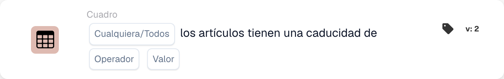

# Los artículos tienen vida útil

<figure><figcaption>
Campos de la tarjeta en la versión mostrada. Los campos aún no están configurados.
</figcaption></figure>

## **Propósito:**

Esta tarjeta de DocBits verifica si los artículos de un conjunto de datos cumplen las condiciones especificadas según su vida útil. La tarjeta permite a los usuarios elegir entre "algún" o "todos" los artículos para la validación y admite varios operadores de comparación. Es ideal para escenarios en los que las decisiones del flujo de trabajo dependen de la vida útil de los artículos, como el control de calidad, la gestión de inventario o las comprobaciones de cumplimiento.

## **Funcionalidad:**

* **Validación de la vida útil:** Esta tarjeta comprueba la vida útil de los artículos frente a una condición especificada. Los usuarios pueden optar por validar **algún** artículo o **todos** los artículos del conjunto de datos y aplicar varios operadores de comparación para definir la condición.
* **Selección de artículos:** Los usuarios pueden elegir entre:
  * **Any Item:** La tarjeta se dispara si al menos un artículo cumple la condición de vida útil especificada.
  * **Todos los artículos:** La tarjeta se dispara solo si todos los artículos cumplen la condición de vida útil especificada.
* **Operadores:** Los siguientes operadores están disponibles para establecer la condición de vida útil:
  * **Igual a (=):** Comprueba si la vida útil es exactamente igual al valor especificado.
  * **No iguales (≠):** Garantiza que la vida útil no sea igual al valor especificado.
  * **Mayor que (>):** Confirma que la vida útil es mayor que el valor especificado.
  * **Mayor o igual (≥):** Garantiza que la vida útil sea mayor o igual que el valor especificado.
  * **Less Than (<):** Comprueba si la vida útil es menor que el valor especificado.
  * **Menos o Igual (≤):** Garantiza que la vida útil sea menor o igual que el valor especificado.

## **Uso:**

Esta tarjeta es adecuada para los equipos de control de calidad, los responsables de inventario o los responsables de cumplimiento que necesitan garantizar que los artículos cumplan requisitos específicos de vida útil antes de continuar con acciones o flujos de trabajo adicionales.

## **Ejemplo de escenario:**

* Un usuario configura la tarjeta para comprobar si **todos los artículos** tienen una vida útil **mayor o igual que 30 días**. Si todos los artículos cumplen esta condición, el flujo de trabajo continúa, confirmando que todos los artículos tienen suficiente vida útil para su venta o distribución.

Al usar la tarjeta "Shelf Life Validation", las organizaciones pueden aplicar estándares de vida útil, mantener la calidad de los productos y garantizar la precisión del flujo de trabajo según las condiciones de vida útil de los artículos.
