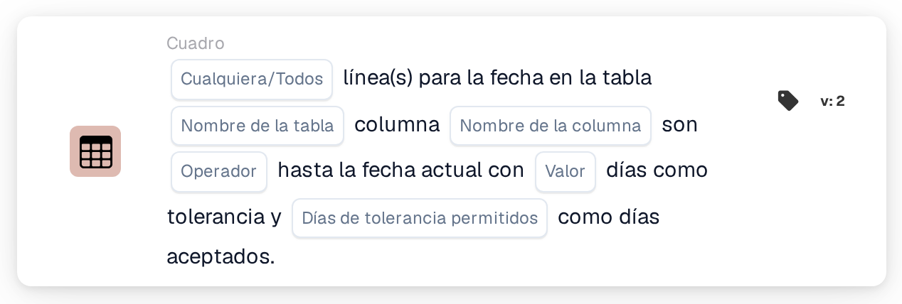

# Fecha de la tabla frente a la fecha actual

<figure><figcaption>
Versión 2
</figcaption></figure>

En [Date Tolerances](../date-tolerances.md) se explica cómo se calcula la ventana de tolerancia, con ejemplos como «hoy o mañana».

## Propósito:

Esta tarjeta de flujo de trabajo compara una fecha de cada línea de una tabla del documento, por ejemplo una fecha de entrega, con la fecha actual. Se puede definir una tolerancia en días y elegir los días de la semana que cuentan, de modo que, por ejemplo, solo se utilicen los días laborables. Puede utilizarse para comprobar si las fechas de un documento están en el pasado, son de hoy, están dentro de unos pocos días o están en el futuro. Según el resultado, el flujo de trabajo continúa con la condición verdadera o con la falsa.

## Componentes de la tarjeta:

1. **Cualquiera/Todos**
   * **Descripción:** Define si una línea o todas las líneas de la tabla deberían cumplir la condición.
   * **Opciones:**
     * **Cualquier:** La condición es verdadera si al menos una línea cumple la condición.
     * **Todos:** La condición solo es verdadera si todas las líneas cumplen la condición.
2. **Nombre de la tabla**
   * **Descripción:** El nombre de la tabla del documento que contiene las fechas.
3. **Nombre de la columna**
   * **Descripción:** La columna de la tabla que contiene la fecha.
4. **Operador**
   * **Descripción:** Define cómo se compara la fecha de la tabla con la fecha actual, teniendo en cuenta la tolerancia.
   * **Opciones:**
     * **Es igual a:** La fecha está dentro del rango de tolerancia en torno a la fecha actual.
     * **No es igual a:** La fecha está fuera del rango de tolerancia.
     * **Mayor Que:** La fecha es posterior al rango de tolerancia.
     * **Mayor o igual que:** La fecha está dentro del rango de tolerancia o es posterior a él.
     * **Menor que:** La fecha es anterior al rango de tolerancia.
     * **Menos o igual:** La fecha está dentro del rango de tolerancia o es anterior a él.
5. **Valor**
   * **Descripción:** La tolerancia en días.
   * **Detalle:** El rango de tolerancia abarca este número de días antes y después de la fecha actual. Solo se cuentan los días seleccionados en **Días de tolerancia permitidos**. Si no se ha definido ningún valor, se utiliza una tolerancia de 0 días, de modo que el rango es únicamente la fecha actual.
6. **Días de tolerancia permitidos**
   * **Descripción:** Los días de la semana que cuentan como días aceptados.
   * **Opciones:** De lunes a domingo; se pueden seleccionar varios días.

## Funcionalidad:

* **Evaluación de la condición:** La tarjeta lee la fecha de la columna seleccionada en cada línea de la primera tabla con el nombre indicado y la compara con la fecha actual (la fecha en UTC). El rango de tolerancia se calcula contando el número de días indicado hacia delante y hacia atrás a partir de la fecha actual. Los días de la semana que no están seleccionados no se cuentan, por lo que el rango se extiende más allá de ellos, y esos días quedan dentro del rango. Por ejemplo, con una tolerancia de 2 días, solo de lunes a viernes seleccionados y un viernes como fecha actual, el rango va del miércoles al martes siguiente.
* **Días aceptados:** Además de la comparación, la fecha de cada línea debería caer en uno de los días de la semana seleccionados. Una línea solo cumple la condición si se superan ambas comprobaciones. A continuación, los resultados de todas las líneas se combinan con **Cualquier** o **Todos**.
* **Ejecución de la acción:**
  * **Condición verdadera:**\
    Las fechas cumplen el operador seleccionado y caen en días aceptados, para alguna o todas las líneas. El flujo de trabajo continúa con la condición verdadera.
  * **Condición falsa:**\
    Si no se cumple la condición, el flujo de trabajo continúa con la condición falsa, por ejemplo para enviar el documento a una revisión manual.
* **Datos que faltan:** La tarjeta no evalúa la condición y registra los datos que faltan en el registro del flujo de trabajo si no se ha definido en la tarjeta ningún nombre de tabla, nombre de columna o día aceptado, si el documento no tiene ninguna tabla con el nombre indicado, si una línea de la tabla no tiene la columna o si la tabla no tiene líneas. Si no se ha definido ninguna opción de **Cualquiera/Todos**, la tarjeta lo anota en el registro y utiliza **Todos**.
* **Errores:** Si un valor de la columna de fecha no puede leerse como fecha, la tarjeta termina con un error.

## Configuración:

* La tarjeta se puede añadir desde la categoría **Cuadro**. A continuación se pueden definir **Cualquier** o **Todos**, el nombre de la tabla, el nombre de la columna, el operador, la tolerancia en días y los días de la semana aceptados. Por último se define la condición de continuación (verdadera o falsa), que determina el siguiente paso del flujo de trabajo.

## Conclusión:

La tarjeta de flujo de trabajo «Table Date to Current Date» comprueba las fechas de las líneas de artículo frente a la fecha de hoy, con una tolerancia que puede limitarse a los días laborables o a cualquier otro conjunto de días de la semana. Así ayuda a señalar los documentos con fechas demasiado tempranas, demasiado tardías o en días que no se aceptan.
