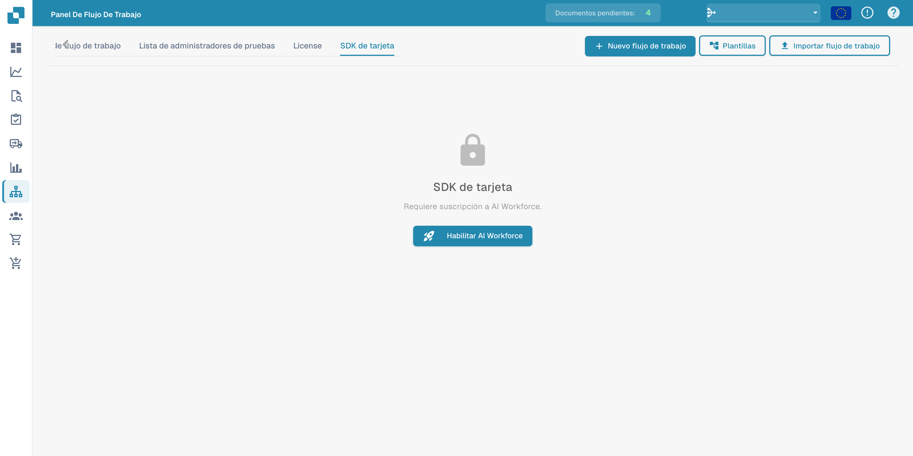

# Card SDK

El **SDK de tarjeta** permite a partners y desarrolladores crear tarjetas de flujo de trabajo personalizadas para DocFlow. Empaquete una tarjeta como una aplicación de partner y súbala, o impórtela directamente desde GitHub.

<figure><figcaption>
Pestaña Card SDK con el aviso de suscripción a AI Workforce.
</figcaption></figure>

## Cómo funciona

- **Descargar plantilla SDK** — comience a partir de la plantilla oficial que contiene la estructura esperada.
- **Subir archivo ZIP** — el ZIP debe contener `app.json` y una carpeta `.docflowcompose/flow/` con las definiciones de las tarjetas (máx. 10 MB). Upload &#x26; Validate comprueba el paquete antes de aceptarlo.
- **Importación de GitHub** — importe una definición de tarjeta directamente desde un repositorio de GitHub.
- **Envíos** — haga seguimiento del estado de las tarjetas que ha enviado.

Una vez validadas y aceptadas, sus tarjetas personalizadas aparecen en la biblioteca **Añadir tarjeta** junto a las tarjetas integradas.
