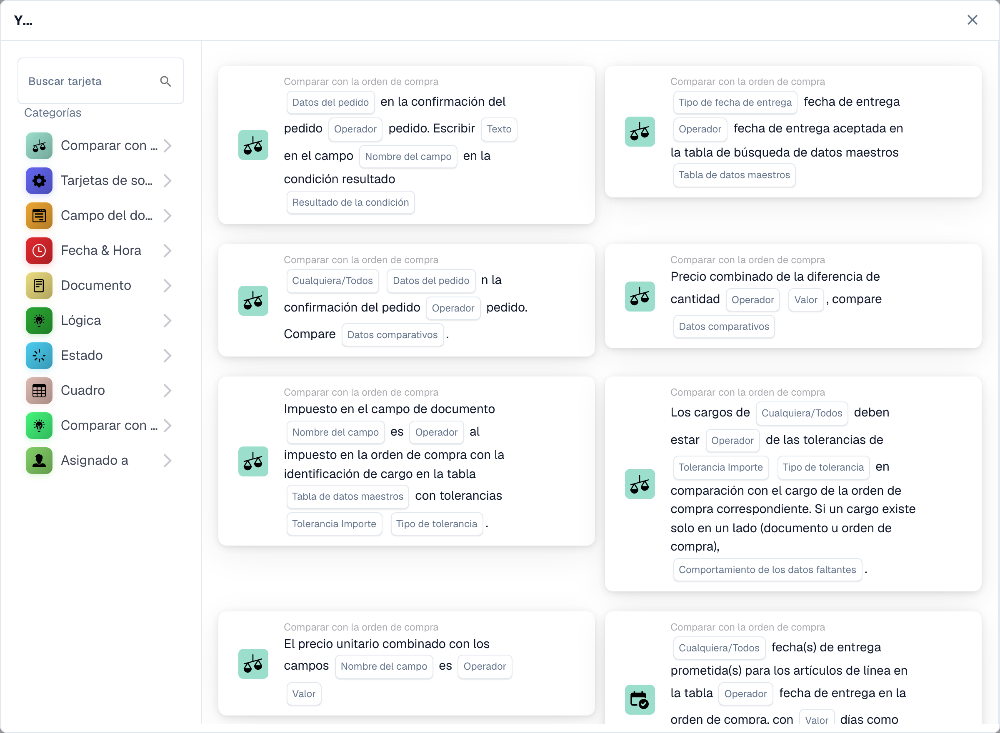

# Tarjetas

Las tarjetas son los componentes básicos de todo flujo de trabajo. Los combina en los grupos **Cuando/Y/Entonces** para describir cuándo se ejecuta un flujo de trabajo y qué hace. Esta sección explica las tarjetas disponibles y lo que hace cada una.

<figure><figcaption>
Tarjetas disponibles en la categoría seleccionada. Configure los campos antes de utilizarlas. Algunas etiquetas de esta versión de la tarjeta todavía tienen una traducción incompleta o incorrecta en la interfaz. Las explicaciones de esta página utilizan los términos correctos.
</figcaption></figure>

## Grupos de tarjetas

* **Cuando**: las tarjetas desencadenantes que inician un flujo de trabajo (por ejemplo, tipo de documento, tipo de documento uno de).
* **Y**: tarjetas de condición que también deben cumplirse antes de que se ejecuten las acciones. Estas incluyen _Comparar con orden de compra_ (coincidencia de PO), comparaciones de _Campos de documento_, _Fecha y hora_, _Lógica_, _Estado_, _Tabla_ y condiciones de _Asignado_.
* **Luego**: tarjetas de acción que hacen el trabajo: establecer campos, aprobar/rechazar, cambiar estado, exportar, crear tareas, asignar documentos, manipular tablas y ejecutar acciones (llamar API, enviar solicitud HTTPS, ejecutar flujo de trabajo, cálculos de IA).

## Guías de referencia de tarjetas

Para obtener una referencia completa de cada tarjeta y sus opciones, consulte las páginas de la _guía completa_ en esta sección (Tarjetas de condición, Tarjetas de coincidencia de PO, Tarjetas de asignación y usuario, Tarjetas de tarea, Tarjetas de campo y tabla, y tarjetas de Acción).

## Combinando cartas

Para ver combinaciones comprobadas de tarjetas que resuelven escenarios comerciales comunes, consulte las **Guías de patrones de flujo de trabajo**.

[Tarjetas lógicas: referencia completa](cards-overview/logic-cards-guide.md).
