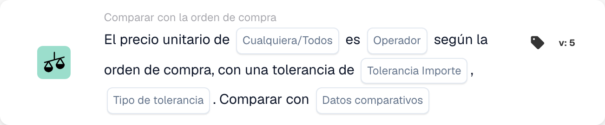

# Versiones de tarjeta y disponibilidad

<figure><figcaption>
Campos de la tarjeta en la versión mostrada. Los campos aún no están configurados.
</figcaption></figure>

Una tarjeta en un flujo de trabajo guardado conserva su ID y versión de tarjeta. Una plantilla más nueva puede agregar campos o cambiar el comportamiento sin cambiar todos los flujos de trabajo guardados previamente. Verifique la versión en la tarjeta real antes de aplicar las instrucciones para una versión más nueva.

## Antes de cambiar una tarjeta guardada

1. Registre sus campos y el resultado actual en datos de prueba representativos.
2. Compare su versión con la referencia, incluidos los valores predeterminados y el comportamiento de datos faltantes.
3. Actualice o reemplace la tarjeta solo mediante la acción del constructor admitida y revise su configuración nuevamente.
4. Valide el gráfico y pruebe los casos de aprobación, falla y datos faltantes antes de activar el flujo de trabajo modificado.

No edite un tipo de tarjeta técnica almacenado simplemente para corregir su ortografía. Los flujos de trabajo existentes pueden depender de ese identificador. Una versión no compatible es un error de ejecución, no una condición comercial falsa.

## Si falta una tarjeta documentada

Verifique el grupo, la categoría, el constructor Estándar versus Avanzado, los módulos habilitados, los permisos y la versión implementada seleccionados Cuándo, Y o Entonces con su administrador. Una tarjeta mencionada en una integración técnica o en una referencia más reciente no necesariamente está habilitada para su organización. No cree ni importe una definición de tarjeta adivinada para solucionar una plantilla faltante.

Las condiciones de calendario adicionales descritas en algunos materiales de desarrollo no son un conjunto seleccionable confirmado en cada versión. El definidor de variables de documento también se implementa sin una plantilla de interfaz de usuario generalizada. Utilice las tarjetas realmente disponibles en su entorno y solicite aclaraciones antes de depender de una que no esté disponible.

## Referencias que dependen de la versión.

- [Tarjetas de exportación](export-cards-guide.md): estado del resultado y exportación inmediata versus en cola.
- [Tarjetas de comparación PO](po-comparison-versions-guide.md): dirección de comparación y base de tolerancia.
- [Tarjetas de comparación de cotizaciones](quote-comparison-guide.md): Cualquiera/Todos y faltan precios comparables.
- [Tarjetas lógicas](logic-cards-guide.md): etiquetas, variables de organización y tipos de entrada.

Utilice [Registros de flujo de trabajo](../workflow-logs.md) para distinguir el éxito, una condición falsa, datos faltantes, un error de configuración y una tarjeta omitida. Registre el estado del documento y la configuración de la tarjeta con el resultado de la prueba; una captura de pantalla del selector de tarjetas por sí sola no establece el comportamiento en tiempo de ejecución.
