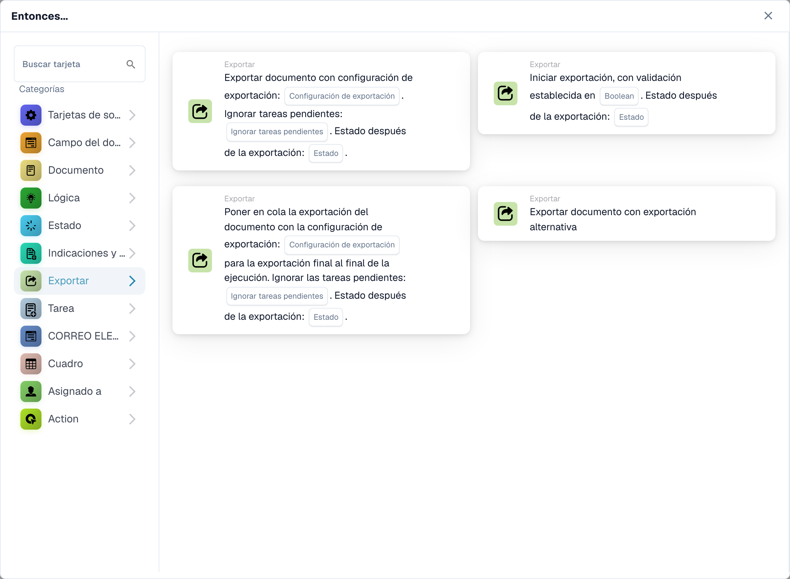

# Tarjetas de exportación de flujo de trabajo y estado de los documentos

<figure><figcaption>
Tarjetas disponibles en la categoría seleccionada. Configure los campos antes de utilizarlas.
</figcaption></figure>

Elija si desea exportar inmediatamente o poner en cola una configuración para la exportación final al final de la ejecución. Estas opciones son independientes del estado que debería tener el documento después de una exportación exitosa.

| tarjeta | Cuando se ejecuta la exportación | Configuraciones importantes |
| --- | --- | --- |
| Iniciar exportación con validación (`EXPORT`) | Inicia la exportación utilizando los ajustes de exportación configurados del documento. | Validación y, a partir de la v4, Estado tras la exportación. |
| Exportar con Configuración de Exportación (`ACTION_EXPORT_WITH`) | Exporta utilizando la configuración seleccionada durante la ejecución de la tarjeta. | Exportar configuración, Ignorar tareas pendientes y, a partir de la v3, Estado tras la exportación. |
| Exportación de cola con configuración (`ACTION_EXPORT_WITH_CONFIG_DEFERRED`) | Recopila la configuración para la exportación final al final de la ejecución. Agregar una solicitud de exportación a la cola no prueba que la exportación final se haya realizado correctamente. | Exportar configuración, Ignorar tareas pendientes y, a partir de la v3, Estado tras la exportación. |
| Exportación alternativa (`ACTION_ALTERNATE_EXPORT`) | Utiliza la ruta de exportación alternativa documentada en su tarjeta. | No asuma que tiene la misma versión u opciones de estado que las tres tarjetas anteriores. |

## Estado después de la exportación

| Valor | Significado después de una exportación exitosa | Uso típico |
| --- | --- | --- |
| `finished` | Exportado y cerrado. | El procesamiento está completo. |
| `exported` | Exportado pero permanece abierto para su posterior procesamiento. | Aún es necesario seguir la aprobación u otro flujo de trabajo. |

Iniciar exportación v4, Exportar con configuración de exportación v3 y exportación en cola v3 ofrecen esta selección. Las versiones anteriores conservan `finished`. Una selección faltante vuelve a `finished` y se registra; un valor no válido se rechaza antes de la exportación. Una tarjeta antigua guardada no adquiere el nuevo comportamiento simplemente porque existe una nueva versión de la plantilla. Inspeccione la versión de la tarjeta y vuelva a probar cualquier actualización explícita.

Las condiciones de estado del documento y Cambiar estado también ofrecen `exported` en las versiones que contienen la actualización de estado correspondiente. El cambio de estado por sí solo no realiza una exportación. Utilice el resultado de la exportación y los registros para establecer que los datos realmente llegaron a su destino.

## Exportación inmediata con configuración

1. Agregue la tarjeta en Luego y seleccione una configuración de exportación válida.
2. Elija si desea ignorar las tareas pendientes. Manténgalo desactivado si las tareas deben bloquear la exportación.
3. En v3, seleccione `finished` o `exported` deliberadamente.
4. Pruebe con un documento en un estado de procesamiento permitido, luego inspeccione el resultado y el destino de la tarjeta.

Si las tareas pendientes impiden la exportación, la tarjeta registra una exportación rechazada. Resuelva las tareas y organice el desencadenador del flujo de trabajo previsto o vuelva a intentarlo. Esta tarjeta no promete esperar y reanudarse automáticamente. Un tiempo de espera tampoco prueba que el sistema remoto no haya hecho nada; inspeccione el historial de exportaciones antes de repetir una operación que podría crear duplicados.

## Exportación de cola con configuración

Agregue esta tarjeta cuando se deba recolectar la exportación para el paso final de la ejecución. Seleccione la configuración, la política de tareas pendientes y el estado del resultado. La tarjeta registra la configuración solicitada; Inspeccione el resultado final de la exportación por separado. El mensaje que confirma la solicitud en cola no es una confirmación de una contabilización contable.

Por ejemplo, seleccione `exported` cuando una exportación exitosa deba dejar el documento disponible para una aprobación posterior. Seleccione `finished` cuando no sea necesario realizar más procesamiento. Vuelva a comprobar el estado final así como el destino de exportación.

## Comprobaciones requeridas

Pruebe una configuración válida, una configuración faltante, tareas pendientes con ambas configuraciones y ambos estados de resultados. Pruebe la versión ya utilizada en un flujo de trabajo existente antes de cambiarla. Para una exportación en cola, verifique la ejecución final; para una exportación inmediata verificar su propio resultado. Revise los [Registros de flujo de trabajo](../workflow-logs.md) y no confunda una tarjeta omitida con éxito.
