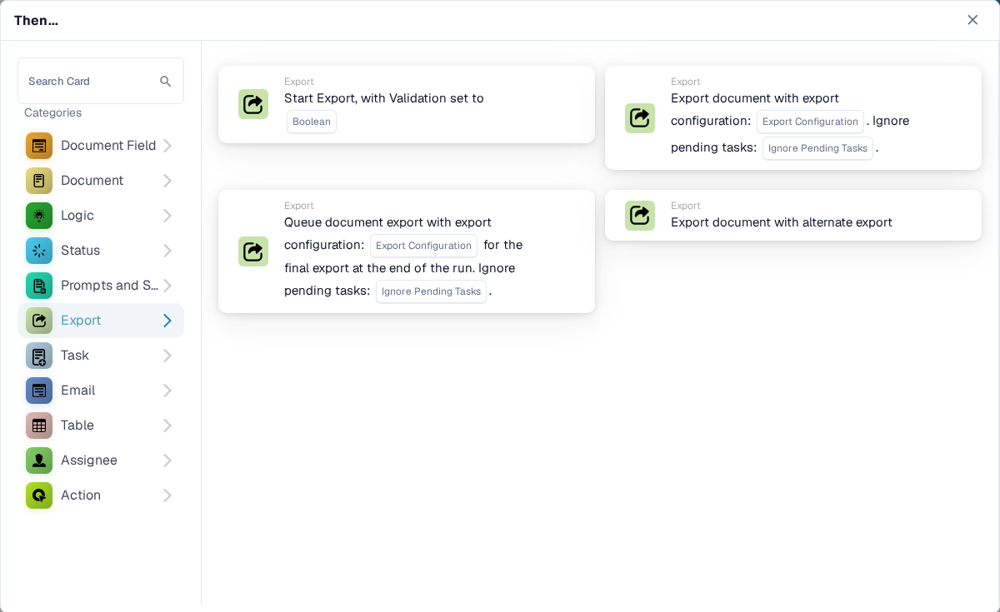

# Then

Una tarjeta **Then** indica a un flujo de trabajo qué debe hacer después de su disparador **When** y de cualquier condición **And**. En el **Workflow Builder**, seleccione **Add Card** bajo **Then...**. Elija una categoría a la izquierda o escriba un nombre en **Search Card**. Seleccione la vista previa de una tarjeta para añadirla, complete los campos que muestra la tarjeta y guarde el flujo de trabajo. Desplácese dentro del selector para ver más tarjetas. Seleccione **×** para cerrarlo sin añadir ninguna tarjeta. Consulte [Flujo de trabajo](../../) para ver la secuencia completa.

Las vistas previas que aparecen a continuación muestran las acciones disponibles, no configuraciones terminadas. Elija la acción que corresponda al resultado que desea obtener.

## Document Field

Active o invierta una casilla de verificación, escriba texto en un campo o copie un campo en otro. Elija los nombres de campo y el valor que solicita la tarjeta. Consulte [Document Field](document-field/).

<figure><figcaption>
Cambie un campo o copie su contenido.
</figcaption></figure>

## Document

Elija **Approve the Document** o **Reject the Document** cuando el flujo de trabajo deba tomar esa decisión. Utilice primero una condición **And** si la aprobación debe depender de una comprobación. Consulte [Document](document/).

<figure><figcaption>
Apruebe o rechace el documento actual.
</figcaption></figure>

## Logic

Utilice estas tarjetas para convertir valores entre los formatos de número, texto y booleano, o para leer un valor de un JSON. Elija los campos de entrada y de salida en la tarjeta seleccionada.

<figure><figcaption>
Transforme valores para un paso posterior del flujo de trabajo.
</figcaption></figure>

## Status

Elija **Change Status** para pasar el documento a un estado seleccionado. La tarjeta también puede disparar otro flujo de trabajo. Consulte [Status](status/).

<figure><figcaption>
Pase el documento a otro estado.
</figcaption></figure>

## Prompts and Scripts

Elija esta categoría para ejecutar un script de prompt de DocOperator. Seleccione el script y las variables que solicita la tarjeta. La tarjeta también ofrece ajustes de ejecución, como los reintentos.

<figure><figcaption>
Ejecute un script de prompt de DocOperator configurado.
</figcaption></figure>

## Export

Inicie una exportación, exporte con una configuración elegida o ponga en cola una exportación final. Elija la configuración de exportación y la opción de tareas pendientes que muestra su tarjeta. Consulte [Export](export/).

<figure><figcaption>
Seleccione cuándo y cómo se exporta el documento.
</figcaption></figure>

## Task

Cree una tarea o una notificación y asígnela a un usuario o a un grupo. Introduzca el título, la descripción, la prioridad y los ajustes de notificación que solicita la tarjeta. Algunas tarjetas asignan de forma secuencial. Consulte [Task](task/).

<figure><figcaption>
Cree trabajo de seguimiento para una persona o un grupo.
</figcaption></figure>

## Email

Envíe un correo electrónico con una plantilla seleccionada, ya sea a destinatarios o a grupos. Elija la plantilla y el destino en la tarjeta.

<figure><figcaption>
Envíe un correo electrónico con plantilla.
</figcaption></figure>

## Table

Cambie entradas o calcule valores en una tabla del documento. Seleccione la tabla, las columnas, el operador y la columna de resultado que solicita la tarjeta. Consulte [Table](table/).

<figure><figcaption>
Actualice o calcule datos de la tabla.
</figcaption></figure>

## Assignee

Asigne el documento a un usuario, grupo, destinatario o suborganización. Algunas tarjetas utilizan un campo o una tabla de decisión y ofrecen una alternativa. Elija el destino y la alternativa adecuados en la tarjeta seleccionada. Consulte [Assignee](assignee/).

<figure><figcaption>
Dirija el documento a la siguiente persona o grupo responsable.
</figcaption></figure>

## Action

Ejecute otro flujo de trabajo, envíe una solicitud HTTPS, llame a una API o utilice la tarjeta de cálculo de aumento de costes. Estas acciones pueden afectar a otros sistemas; consulte a su administrador qué endpoint y qué ajustes debe utilizar. Consulte [Action](action/).

<figure><figcaption>
Inicie otro flujo de trabajo o una acción de integración.
</figcaption></figure>
