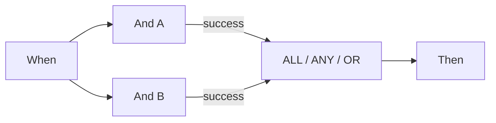

# P0: Conectar Wait ALL, Wait ANY y OR correctamente

ALL exige una salida conectada coincidente de **cada origen distinto**. ANY y OR necesitan al menos un origen coincidente. Conectar verde y naranja desde el mismo origen sigue contando una sola vez. OR no crea una bifurcación exclusiva ni cancela otras acciones. ANY tampoco promete que gane la rama más rápida.

El planificador revisado espera primero a todos los predecesores entrantes. Si una rama no elegida deja un predecesor inalcanzable, la ejecución normal omite la unión bloqueada. El modo de prueba puede evaluarla con los resultados disponibles. **Una prueba parcial en verde no demuestra que una ejecución documental continúe por ese grafo.**

Para dos comprobaciones obligatorias, ejecute ambas y conecte las salidas necesarias a ALL. Para rutas alternativas de esta versión, utilice la tarjeta Then final común del caso v2. Esa convergencia corresponde a rutas mutuamente excluyentes; no es una barrera para varias acciones simultáneas.

Compruebe por separado origen, salida conectada, salida elegida y accesibilidad real. Un origen con Error mantiene el error global aunque ANY/OR termine correctamente. En el código revisado, un ALL no satisfecho también contiene un detalle de error; su color naranja no basta como prueba.

## Tarjetas y parámetros de ejemplo

Los valores describen parámetros de tarjetas, no un workflow completo importable. Sustituya YOUR_* por selecciones propias de prueba. El diseñador gestiona el ID oculto del llamante. Catálogo: Dev, DocFlow 2.10.38, 21 de octubre de 2026; compruebe versiones y permisos de su organización.

`node_type`: `all`, `any`, `or`

## Casos de prueba de negocio

| Caso | Entrada / configuración | Resultado esperado |
| --- | --- | --- |
| MERGE-01 | A=success; B=success | ALL/ANY/OR: join=success |
| MERGE-02 | A=success; B=failed_condition; B→failed_condition: — | ALL: join=failed_condition, workflow=error; ANY/OR: join=success, workflow=failed_condition |
| MERGE-03 | A=success; B=error | ANY/OR: join=success; workflow=error |
| MERGE-04 | A=success; B=no alcanzado | test: evaluar; planificador: omitir |
| MERGE-05 | A→success + A→failed_condition; B→success | sources=2 |

## Pruebas y límites

Se comprobaron resultados seleccionados de tarjetas y nodos con datos sintéticos en Advanced Test. Las respuestas están en el paquete. Las acciones documentales son simuladas; no prueban una ejecución persistida ni una entrega externa.

[Continuar aprendiendo](../workflow-learning-path.md) · [Paquete de formación](../workflow-training-kit.md)
