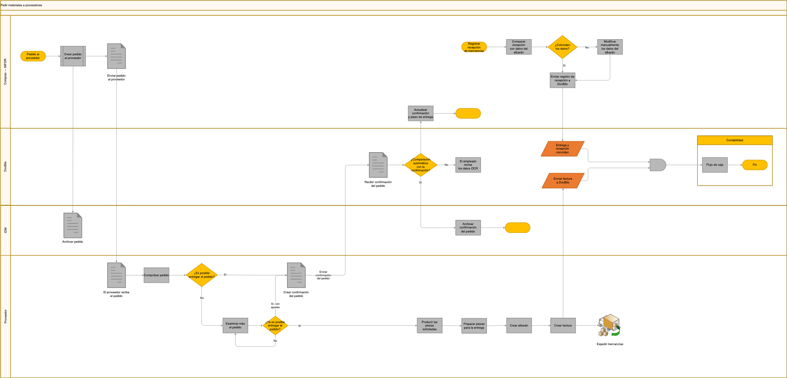

# Flujo de trabajo de pedido y procesamiento de materiales

El diagrama presenta un flujo de ejemplo entre compras, proveedor, IDM, DocBits y contabilidad. Ajuste los responsables, las comprobaciones y las integraciones a su configuración.

## Pedido y confirmación

Compras crea el pedido en INFOR, lo archiva en IDM y lo envía al proveedor. El proveedor comprueba si puede entregar las piezas. Puede confirmar el pedido, proponer ajustes o seguir examinándolo.

En el ejemplo, DocBits recibe la confirmación y comprueba si puede compararla automáticamente con el pedido. Cuando no es posible, el empleado revisa los datos OCR. El esquema contempla archivar la confirmación en IDM o actualizar la confirmación y el plazo de entrega.

## Entrega, recepción y factura

El proveedor prepara las piezas, crea el albarán y la factura y expide las mercancías. La factura se envía a DocBits. Compras registra la recepción y la compara con el albarán; si encuentra una discrepancia, el esquema contempla una corrección manual de los datos antes de enviar el registro de recepción a DocBits.

## Destino contable

La factura y la comprobación de entrega y recepción convergen en el destino contable del ejemplo. Compruebe la configuración y los resultados de su propio proceso. El diagrama no acredita un registro contable o un pago ejecutado.

<figure><figcaption>
Flujo de ejemplo para pedidos de materiales, confirmaciones, recepciones de mercancías y facturas entre proveedor, compras, IDM, DocBits y contabilidad. Adapte los controles y las integraciones a su configuración.
</figcaption></figure>
